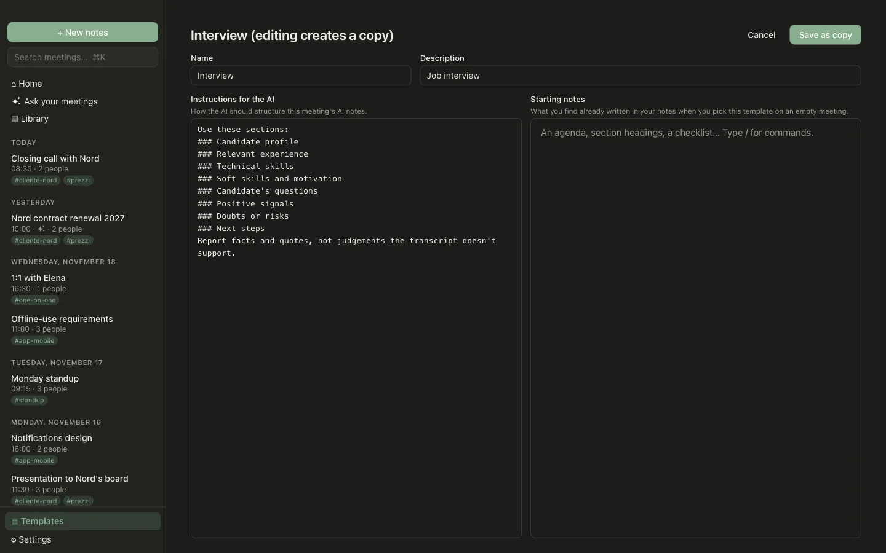

## AI notes

**Generate AI notes** merges your own notes and the transcript into complete notes, with context, decisions and next steps. The text appears as it is written, and you can stop it.

- The AI notes are editable, like your own notes.
- Your own notes are not replaced: they stay in the **My notes** tab.
- **Regenerate** asks for confirmation, because it replaces the current AI notes and your edits to them. If a regeneration fails, the existing AI notes are left untouched.
- The moments you marked while recording tell the AI which parts mattered to you.

## Templates

A template tells the AI how to structure the notes. Granello comes with General, 1:1, Standup, Interview and Client meeting, and you can add your own in **Templates**.

A template has two parts:

- **Instructions for the AI**: the sections and the rules for the AI notes.
- **Starting notes** (optional): an agenda, section headings or a checklist, written with the same editor as your notes. They fill your notes when you pick the template on a meeting whose notes are still empty. Notes you already wrote are never replaced.

### Set up a template with AI

Below the two columns, **Set up with AI** writes the template for you. Describe it in your own words, for example "sprint retro with what went well, what to improve and action items", then press **Generate** (or Enter).

- The AI writes the instructions and the starting notes. It fills the name and the description only if they are empty, so what you already typed there stays.
- If the template already has instructions or starting notes, the button becomes **Update**: describe what to change ("add a section for risks") and the rest is kept.
- Nothing is saved on its own: review the fields, change what you want, then press **Save**. **Undo** puts the fields back as they were before the AI's suggestion.
- It uses the model chosen for AI notes in **Settings**. If no model is ready, the message says what to set up there.

Your description and the template's current fields go to that model; no meeting is sent. See [what can leave your Mac](/privacy/overview/).

Built-in templates cannot be changed: editing one saves a copy.

You choose the template of each meeting in its header.

## Chat

- **Ask** inside a meeting answers from that meeting's notes and transcript.
- **Ask your meetings** in the sidebar answers across all meetings: a full-text search finds the relevant ones, and the answer cites their title and date.

The chat sends text to the AI provider you configured. Meetings that may not go to that model, because they are hardened or have parts to review, are left out. See [privacy levels](/privacy/levels/).
