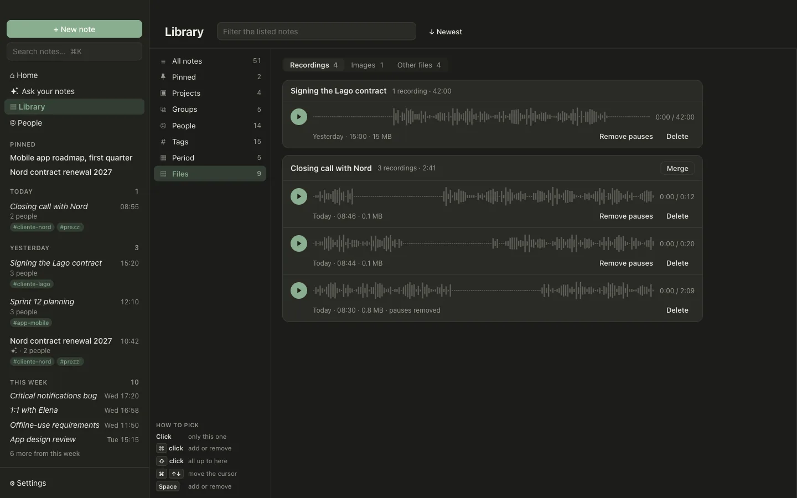

The Library browses your meetings in columns: pick a dimension, then a value, then a meeting, with a preview next to it.

## Dimensions

- **Projects**: tags you promoted. A project has its own section and can be archived when it is done.
- **People**: who took part.
- **Tags**: the other tags.
- **Period**: this week, then one group per month.
- **Recordings**: the saved audio, see below.

Arrow keys move through the columns and Enter opens the meeting.

## Projects are tags

A meeting joins a project simply by carrying its tag. To make a project, go to **Tags**, hover a tag and choose **Project**. To close one, choose **Archive**: its meetings stay.

## Cross two dimensions

**+ Cross with…** at the top narrows everything to the meetings that also have one more thing: a person inside a project, a tag in a month.

## Tag several meetings at once

⌘-click or Shift-click selects several meetings. The preview then lets you add a tag to all of them, or remove one from all of them.

## Items across meetings

The **Items** switch lists, instead of the meetings, what is written in their notes:

- **decisions**, from decision callouts;
- **actions**, from checklists, open or done;
- **quotes**, from transcript quotes.

Filter by type with the chips at the top, and search in their text. Double-click an item to open its meeting.

## Recordings

With **Save recordings** on, the Library shows one card per meeting with its recordings. Each has a player with the audio waveform: click or drag it to move.

- **Remove pauses** cuts the silent parts. Afterwards the audio's minutes no longer match the transcript.
- **Merge** joins the recordings of a meeting recorded in several takes into one file.

Both use ffmpeg, which release packages include. With it, recordings are also compressed, to about 20 MB per hour. A build from source without ffmpeg keeps recordings as WAV and does not offer these two actions.

## Search

The search field in the sidebar (⌘K) looks in titles, tags, participants, notes, AI notes and transcripts. Redacted text is not found, because it no longer exists.
