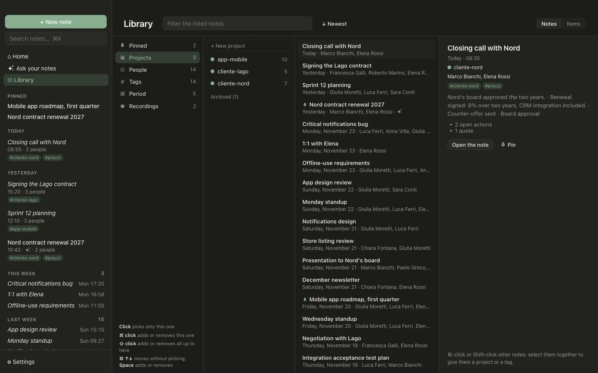
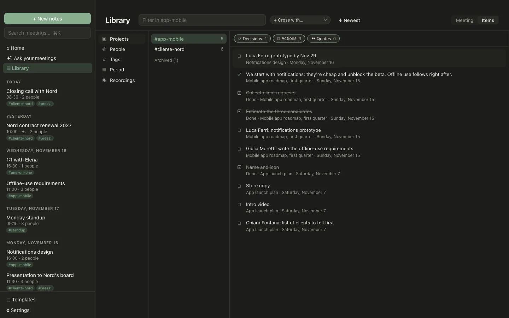

The Library browses your notes in columns: pick a dimension, then a value, then a note, with a preview next to it.

## Dimensions

- **Pinned**: the notes you pinned to the sidebar, see below.
- **Projects**: the projects you created, each with the notes that belong to it.
- **People**: who took part.
- **Tags**: the tags on your notes.
- **Period**: this week, then one group per month.
- **Recordings**: the saved audio, see below.

Arrow keys move through the columns and Enter opens the note; Shift + arrow also adds the next entry or dimension. ⌘ + ↑↓ moves without changing what is picked, and Space then picks or removes the entry under the cursor (in the list of notes, it adds or removes the note from the selection).

## Projects

A project collects the notes that belong together: a client, a product, a piece of work. **+ New project** at the top of the Projects column creates one, with a name, a color and a description.

A note belongs to one project at most. To put a note in a project, open it and choose the project at the top right of the header, above the copy, print and delete buttons; from there you can also create a new project. To move several notes at once, select them in the Library and choose the project in the preview.

Hover a project to edit it (✎), archive it when it is done (⤓) or delete it (×). Archiving and deleting keep the notes: an archived project moves under **Archived**, and the notes of a deleted project are left without a project.

Projects made with earlier versions, when a project was a promoted tag, are converted on the first launch: each one keeps its name and its notes, and the tag stays on the notes as a plain tag.

## Pinned notes

The pin in a note's header, next to copy, print and delete, keeps it in the sidebar under **Pinned**, in the order you pinned them. Press it again to unpin. You can also pin or unpin from the Library preview, or pin several selected notes at once.

## The sidebar

Under **Library** the sidebar shows, in order:

- **Coming up**: the calendar events of the next hours.
- **Pinned**: the notes you pinned.
- **Today** and **Yesterday**: each note with the time it was last changed, ✦ when the AI has enhanced it, how many people took part and up to two tags. A title in italics is a note not enhanced by the AI yet.
- **This week** and **Last week**: one line per note with the weekday and time of its last change, and how many notes the week has. The first four are shown; **N more** shows the rest.
- **All notes**, at the bottom, opens the Library.

These sections go by the last change, the most recent first: editing the title, the notes, the AI notes, the participants or the tags of an older note brings it back under **Today**. Tagging several notes at once from the Library does not move them. In the note itself, the date at the top says when it was last edited, if that was more than an hour after the recording ended.

During a search the sidebar shows only the results, the most relevant first, with the matching text; the sections come back when the search field is empty.

## Several values, several dimensions

The columns work like the Finder: a click picks one entry, ⌘-click adds or removes one, Shift-click adds every entry up to there, or removes them if the one you click was already picked, ⌘A picks the whole column. The key list at the bottom of the first column recalls this. Picked entries stay green in every column, and people and tags are in alphabetical order, so filtering changes the numbers, not where entries sit. The number next to each dimension says how many entries its column has among the notes you are looking at.

- **Several values in one column.** Two people show the notes where both took part, and the same goes for two tags. Two projects or two months show the notes of either one, since a note has only one.
- **Several dimensions together.** ⌘-click a second dimension and its column opens next to the first: pick two people, ⌘-click **Tags**, and the new column lists only the tags of their notes. The last dimension you added always has the right-hand column; the earlier ones stack in the left-hand column, splitting its height: ⌘-click **Period** too and People and Tags share the left column while Period takes the right one. Each column counts its entries on the notes chosen in the others, and the list of notes shows the ones that pass them all. ⌘-click **Pinned** to see only pinned notes.

A column with nothing picked does not filter. A plain click on a dimension closes the others; Esc clears what is picked in the column you are in. In a narrow window the Library scrolls sideways, keeping the column you are in visible.

## Several notes at once

⌘-click or Shift-click selects several notes. The preview then lets you choose the project for all of them, add a tag to all of them, or remove one from all of them.

## Items across notes

The **Items** switch lists, instead of the notes themselves, what is written in them:

- **decisions**, from decision callouts;
- **actions**, from checklists, open or done;
- **quotes**, from transcript quotes.

Filter by type with the chips at the top, and search in their text. Double-click an item to open its note.

## Recordings

With **Save recordings** on, the Library shows one card per note with its recordings. Each has a player with the audio waveform: click or drag it to move.

- **Remove pauses** cuts the silent parts. Afterwards the audio's minutes no longer match the transcript.
- **Merge** joins the recordings of a note recorded in several takes into one file.

Both use ffmpeg, which release packages include. With it, recordings are also compressed, to about 20 MB per hour. A build from source without ffmpeg keeps recordings as WAV and does not offer these two actions.

## Search

The search field in the sidebar (⌘K) looks in titles, tags, participants, notes, AI notes and transcripts. Redacted text is not found, because it no longer exists.
