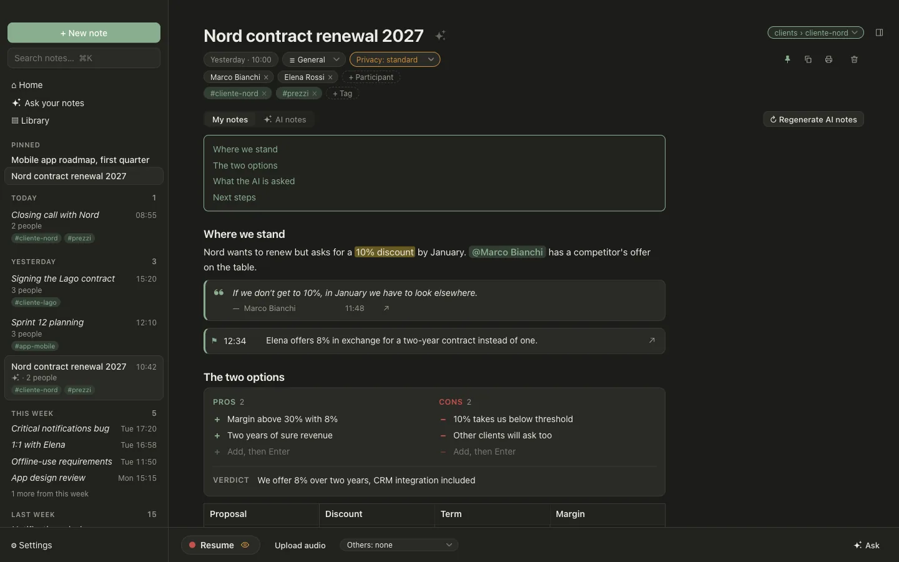
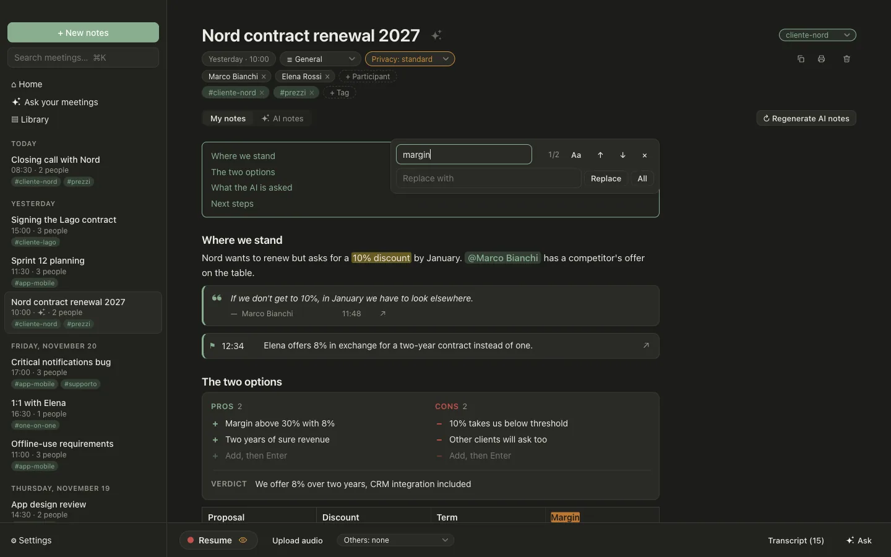

Notes are written in a Markdown editor and saved as you type. Type `/` for the [command menu](/reference/slash-commands/); select text for the formatting bar.

## Blocks

Everything is saved as readable Markdown, so your notes are still yours outside Granello.

| Block | How to insert it | In Markdown |
| --- | --- | --- |
| Table | `\|` + space | a Markdown table |
| Callout | `!` + space | `> [!NOTE]`, `> [!WARNING]`, `> [!DECISION]` |
| Collapsible section | `/` menu | `::: details Title` … `:::` |
| Columns | `/` menu | `:::: columns` with a `::: column` each |
| Image, attachment | paste, drop or `/` menu | `` |
| Link preview | `/` menu | `[Title](https://… "preview")` |
| Formula | `$x^2$`, `$$` + space | `$…$`, `$$` … `$$` |
| Table of contents | `/` menu | `[[toc]]` |
| Highlight | ⌘⇧H | `==text==` |
| Person | `@` | `@[Name]` |
| Date | `/` menu | `[[2026-11-26]]` |
| Link to a note | `[[` or `/` menu | `[[Title]]`, `[[Title\|text]]` |
| Poll | `/` menu | `::: poll Question` |
| Kanban board | `/` menu | `::: kanban` |
| Timeline | `/` menu | `::: timeline` |
| Pros and cons | `/` menu | `::: pros-cons` |
| Decision matrix | `/` menu | `::: matrix` around a table |
| Star rating | `/` menu | `[[rating:4]]` |
| Timer | `/` menu | `[[timer:05:00]]` |
| Progress bar | `/` menu | `[[progress]]` |
| Chart | `/` menu | `[[chart:bar]]`, `[[chart:line]]` |
| Diagram | `/` menu | a `mermaid` code block |
| Whiteboard | `/` menu | a `sketch` code block |
| Embed | `/` menu | `[Title](https://… "embed")` |
| Live AI block | `/` menu | `::: ai Request` … `:::` |
| Transcript quote | select text in the transcript | `::: quote 12:34 Name` … `:::` |
| Moment marker | ⇧⌘M while recording | `::: moment 12:34` … `:::` |

## Quotes from the transcript

Select a sentence in the Transcript panel and press **❝ Quote**. The note gets a quote with who said it and the minute; ↗ on the quote reopens the transcript at that point. While recording, **❝ Quote** at the bottom of the panel (or in the bar under the note, with the panel closed) quotes the last transcribed sentence without selecting anything. From the `/` menu the quote is empty, at the current minute of the recording.

## Find and replace

⌘F opens find and replace inside a note. Matches are highlighted, Enter and Shift Enter move between them, and **All** replaces every match with a single undo. It searches the note's text; blocks made of data (polls, kanban boards, quotes) are left out.

## Copy, print, delete

The three icons at the top right of a note copy it as Markdown, print it (or save it as PDF) and delete it.

## AI inside the editor

- A **live AI block** holds a request, such as "summarize the client's objections", and its answer. The answer is recomputed while you record and once more when the transcription ends.
- **✦** on a poll, kanban board, timeline, pros and cons, decision matrix or diagram creates or edits the block from a request.
- **✦** on selected text rewrites it: shorten, translate, expand.
- **✦** next to the title proposes a title from notes and transcript.

Each of these sends the notes and the transcript to the AI provider you configured. See [privacy levels](/privacy/levels/) for notes where that must not happen.
