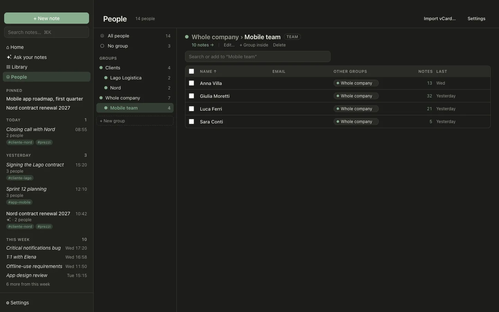

**People**, in the sidebar, lists everyone who appears as a participant in your notes, and the groups they belong to. Granello suggests them when you add participants to a note, and adds new ones on its own.

## Groups

A group brings people together: a team, a department, a client, the whole company. Groups sit inside other groups, like projects (`Whole company › Mobile team`), and the column on the left shows them as a tree, with **All people** and **No group** above them. Pick a group to see its members.

**+ New group** asks for a name, the group that contains it, a color and how the group enters a note:

- **Team**: adding it to a note also adds its members as attendees, one by one. Untick anyone who wasn't there. Good for a standup, a project team, a committee.
- **Audience**: the note shows a single chip and nobody is added. Tick only who spoke or should be named. Good for the whole company or a department, where listing everyone would bury the note.

New groups with more than 15 people start as an audience; you can change it in **Edit…**, where you can also add the group's **mailing list** (`all@company.com`): a calendar invitation sent to that address is an invitation to the group.

To fill a group, open it and type in the search field: below it Granello offers the people who match and, if the name is new, adds it as a new person (Return adds the only suggestion). To add many at once, paste a list in the same field: one person per line, with the email if you have it (`Name <email>`, or name and email in two spreadsheet columns). Granello recognises people already in the list by their email or name, and asks before adding them. Deleting a group asks for confirmation and leaves the notes and the people as they are.

## Groups in a note

Below a note's title, **+ Group** adds a group. Click the group's chip to see its members and tick who was there; × removes the group but keeps the attendees. When all the members of a team are already attendees, Granello suggests the team next to the chips.

Someone was there who isn't in the group? The chip's panel lists the note's attendees who are not members (**+ Name** adds them), and has a field to add anyone else, with suggestions from your people. When an attendee is in no group at all, like a new colleague, Granello suggests adding them to the note's team (**+ Name in “Team”?**); the × next to it stops suggesting that person for that group. The group's notes are listed in the [Library](/guides/library/), under **Groups**.

From the calendar: when the event invited a group's mailing list, the note offers that group (**+ Whole company from “All-hands”**); mailing lists and meeting rooms are never imported as attendees. An event with more than 15 invitees offers the group that already holds almost all of them, or **Group with the N invitees…** to create one, instead of adding everyone one by one.

While recording a meeting with an audience group, the **At the mic** menu also offers **Audience (Whole company)**, for the questions from the floor; **Who's speaking…** offers it too.

AI notes and the chat receive the group's name, kind and size (*Whole company (audience, 124 people)*), never the list of its members.

## The list

Every row is the same height: name, email, role, groups, number of notes and the date of the last one. In a narrow window the role sits next to the name. A `≈` next to a name means the person has other names (in the tooltip). Click a column heading to sort by it, and again to reverse the order. Click the number of notes to open them in the [Library](/guides/library/). With a group open, the Groups column shows only the person's *other* groups.

A group chip has a × that appears on hover: it takes the person out of that group without opening it. If someone is in more groups than fit, the row shows the first ones and `+N`, with the rest in the tooltip.

## Select several people

Click a row (or its checkbox) to select it; Shift-click selects everything in between, ⌘A the whole list, Esc clears the selection. The keyboard works too: ↑↓ move, Shift + ↑↓ select as you go, Space selects the row, Return edits it.

With people selected, the search bar becomes their toolbar:

- **Group…**: add them to a group or to a new one; with a group open, move them to another group or take them out.
- **Merge**, with exactly two selected: the one with fewer notes merges into the other (you can still change who stays).
- **Remove** takes them out of the list and their groups, after a confirmation; the notes stay as they are.

## Fix a name

Double-click a name, an email or a role (or Return on the selected row) to edit it in place. Return saves and moves to the same field on the next row, Shift + Return to the row above, Esc cancels: filling in forty emails is forty lines of typing, not forty dialogs. The new name reaches every note: the participants, the @mentions in notes and AI notes, who said what in transcript quotes, and the groups. A name that already belongs to someone else is not taken: merge the two instead.

✎ opens all of a person's details: name, email, role and **other names** (a nickname, an initial, how the calendar writes them). Written that way among the attendees, or arriving that way from the calendar or with their email, Granello recognises the person: “E. Rossi” becomes Elena Rossi. Renaming someone keeps the old name among the other names.

## Merge two people

The same person often ends up written in two ways ("Marco" and "Marco Bianchi"). Hover the one to remove, press ⇢ and choose who it really is. Its notes move to the other person, without duplicates, the other person takes the email and role if they had none, and the removed name becomes one of their other names.

Under **To tidy up**, on the left, **Possible duplicates** lists the pairs that look like the same person: same email, the same name written differently (“Rossi, Elena”), or with an initial (“E. Rossi”). **Merge into…** keeps the person with more notes, **The other way round** keeps the other one, **Two different people** stops suggesting the pair. **No notes** lists the people in no note, to remove the ones you don't need.

Removing someone (×, then confirm) takes them out of the list and of their groups: the notes stay as they are.

## Import from a file

**Import vCard or CSV…** reads a `.vcf` file exported from Contacts, Google Contacts or Outlook, or a CSV list (comma, semicolon or tab). In a CSV, a header row in English or Italian names the columns: name (or first and last name), email, role and group. A group written `Company/Sales` goes inside `Company`; several groups in one cell are separated by `|`. Groups that don't exist yet are created, and people join them. Granello shows who is in it, and you choose who to add: people already in the list are unticked and get the email and role, if they had none. With a group open, the people you add can join it too. Nothing is added until you press **Add**.

## Your Mac's contacts

In **Settings → People**, turn on **Suggest people from your contacts** and, the first time, macOS asks for permission. From then on, while you type a participant, Granello also suggests names from your contacts and takes their email. **Fill missing emails** looks up, in your contacts, the people in the list who have no email yet.

Granello reads only the names you search for: your contacts are not copied, and they stay on your Mac. The option is off by default. To stop it, turn it off there or remove the permission in *System Settings → Privacy & Security → Contacts*.
