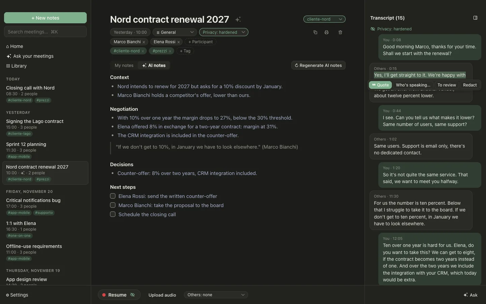
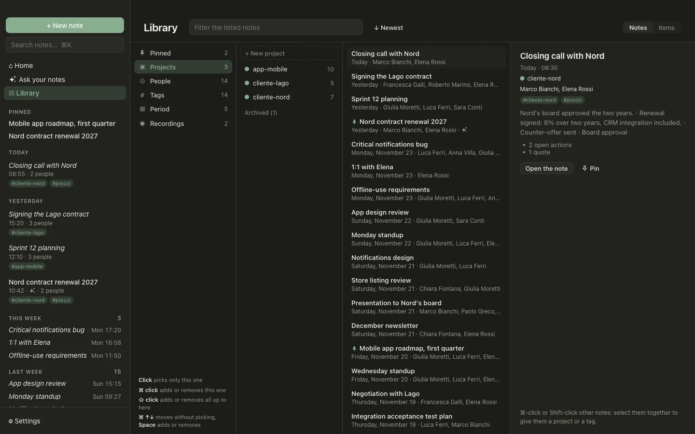

import { Card, CardGrid } from "@astrojs/starlight/components";

## Privacy is the product

<CardGrid>
  <Card title="Transcribed on your Mac" icon="laptop">
    Speech becomes text on your Mac, with whisper.cpp. By default the audio is transcribed and discarded: it is
    not saved and not uploaded.
  </Card>
  <Card title="A privacy level per meeting" icon="approve-check-circle">
    Standard, local audio or hardened. With hardened, nothing leaves the Mac: the AI features use a local model
    or are not available.
  </Card>
  <Card title="Redact and review" icon="pencil">
    Select a sentence in the transcript and redact it for good, or mark it to review. A meeting with parts to
    review is not sent to online models.
  </Card>
  <Card title="No bot in the call" icon="seti:audio">
    Granello listens to your microphone and to what your computer plays. Nothing joins the meeting, and the
    other participants see nothing new.
  </Card>
  <Card title="Your models, your keys" icon="setting">
    The AI notes use the provider you choose, with your own API key in the Keychain. With a local provider,
    nothing leaves your Mac.
  </Card>
  <Card title="Open source" icon="github">
    The code is public under the MIT licence, so what Granello does with your meetings can be read, not just
    promised.
  </Card>
</CardGrid>

## What it does

- **During the meeting** you write a few lines. Granello records, shows the audio levels, and lets you mark a moment with one key.
- **Afterwards** an AI model merges your notes and the transcript into complete notes, following a template you choose.
- **Later** the Library finds meetings by project, person, tag and period, and lists the decisions and actions written across them.

Granello is in development: there is no published release yet. You can [build it from source](/start/install/).
