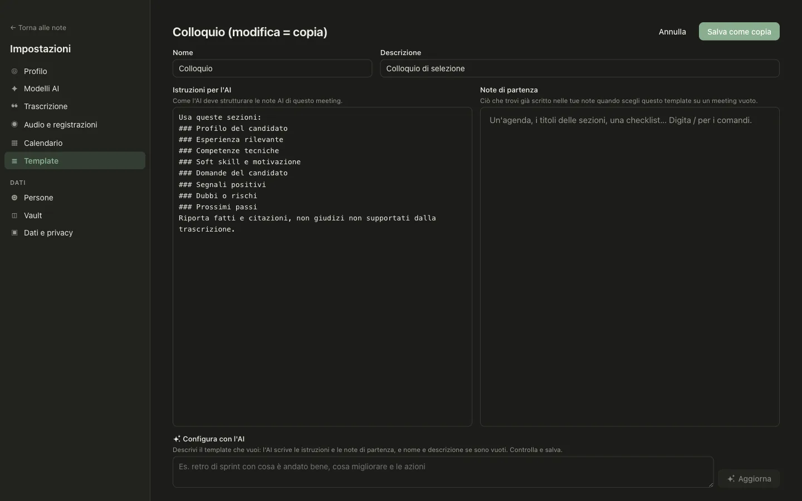

## Note AI

**Genera note AI** unisce i tuoi appunti e la trascrizione in note complete, con contesto, decisioni e prossimi passi. Il testo compare mentre viene scritto, e puoi interromperlo.

- Le note AI sono modificabili, come le tue.
- Le tue note non vengono sostituite: restano nella scheda **Le mie note**.
- **Rigenera** chiede conferma, perché sostituisce le note AI attuali e le tue modifiche. Se una rigenerazione fallisce, le note AI esistenti restano come sono.
- I momenti che hai segnato mentre registravi dicono all'AI quali parti contavano per te.

## Template

Un template dice all'AI come strutturare le note. Granello ha Generale, 1:1, Standup, Colloquio e Meeting cliente, e puoi aggiungere i tuoi in **Impostazioni → Template**.

Un template ha due parti:

- **Istruzioni per l'AI**: le sezioni e le regole per le note AI.
- **Note di partenza** (facoltative): un'agenda, i titoli delle sezioni o una checklist, scritti con lo stesso editor delle note. Riempiono le tue note quando scegli il template su un meeting con le note ancora vuote. Le note che hai già scritto non vengono mai sostituite.

### Configurare un template con l'AI

Sotto le due colonne, **Configura con l'AI** scrive il template per te. Descrivilo a parole tue, per esempio "retro di sprint con cosa è andato bene, cosa migliorare e le azioni", poi premi **Genera** (o Invio).

- L'AI scrive le istruzioni e le note di partenza. Riempie nome e descrizione solo se sono vuoti, così quello che hai già scritto lì resta.
- Se il template ha già istruzioni o note di partenza, il pulsante diventa **Aggiorna**: descrivi cosa cambiare ("aggiungi una sezione per i rischi") e il resto viene conservato.
- Non si salva nulla da solo: controlla i campi, cambia quello che vuoi, poi premi **Salva**. **Ripristina com'era** riporta i campi a prima della proposta dell'AI.
- Usa il modello scelto per le note AI nelle **Impostazioni**. Se nessun modello è pronto, il messaggio dice cosa configurare lì.

La tua descrizione e i campi attuali del template vanno a quel modello; nessun meeting viene inviato. Vedi [cosa può uscire dal Mac](/it/privacy/overview/).

I template di sistema non si modificano: modificandone uno si salva una copia.

Il template di ogni meeting si sceglie nella sua intestazione.

## Chat

- **Chiedi** dentro un meeting risponde dalle note e dalla trascrizione di quel meeting.
- **Chiedi ai meeting** nella barra laterale risponde su tutti i meeting: una ricerca nel testo trova quelli pertinenti, e la risposta cita titolo e data.

La chat invia testo al provider AI che hai configurato. I meeting che non possono andare a quel modello, perché blindati o con parti da verificare, restano fuori. Vedi [livelli di privacy](/it/privacy/levels/).
