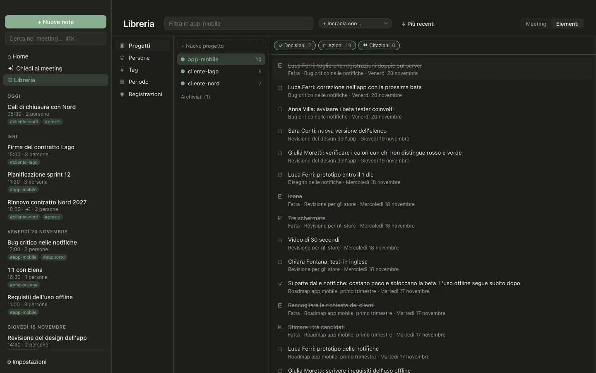

La Libreria sfoglia i meeting a colonne: scegli una dimensione, poi un valore, poi un meeting, con l'anteprima accanto.

## Dimensioni

- **Fissati**: i meeting che hai fissato nella barra laterale, vedi sotto.
- **Progetti**: i progetti che hai creato, ognuno con i meeting che gli appartengono.
- **Persone**: chi ha partecipato.
- **Tag**: i tag dei tuoi meeting.
- **Periodo**: questa settimana, poi un gruppo per mese.
- **Registrazioni**: l'audio salvato, vedi sotto.

Le frecce muovono tra le colonne e Invio apre il meeting; Maiusc + freccia aggiunge anche la voce o la dimensione successiva. ⌘ + ↑↓ si sposta senza cambiare cosa è scelto, e Spazio sceglie o toglie la voce dove sei (nell'elenco dei meeting, lo aggiunge o lo toglie dalla selezione).

## Progetti

Un progetto raccoglie i meeting che vanno insieme: un cliente, un prodotto, un lavoro. **+ Nuovo progetto** in cima alla colonna Progetti ne crea uno, con nome, colore e descrizione.

Un meeting sta in un progetto al massimo. Per mettere un meeting in un progetto aprilo e scegli il progetto in alto a destra nell'intestazione, sopra i pulsanti copia, stampa ed elimina; da lì puoi anche creare un progetto nuovo. Per spostare più meeting insieme selezionali nella Libreria e scegli il progetto nell'anteprima.

Passando su un progetto puoi modificarlo (✎), archiviarlo quando è chiuso (⤓) o eliminarlo (×). Archiviare ed eliminare tengono i meeting: un progetto archiviato va sotto **Archiviati**, e i meeting di un progetto eliminato restano senza progetto.

I progetti creati con le versioni precedenti, quando un progetto era un tag promosso, vengono convertiti al primo avvio: ognuno tiene il nome e i suoi meeting, e il tag resta sui meeting come tag normale.

## Meeting fissati

La puntina nell'intestazione di un meeting, accanto a copia, stampa ed elimina, lo tiene nella barra laterale sotto **Fissati**, nell'ordine in cui li hai fissati. Premila di nuovo per toglierlo. Puoi fissare o togliere anche dall'anteprima della Libreria, o fissare insieme più meeting selezionati.

## La barra laterale

Sotto **Libreria** la barra laterale mostra, in ordine:

- **In arrivo**: gli eventi del calendario delle prossime ore.
- **Fissati**: i meeting che hai fissato.
- **Oggi** e **Ieri**: ogni nota con l'ora, ✦ se l'AI l'ha rielaborata, quante persone c'erano e al massimo due tag. Un titolo in corsivo è una nota non ancora rielaborata dall'AI.
- **Questa settimana** e **Settimana scorsa**: una riga per nota con il giorno della settimana e l'ora, e quante note ha la settimana. Si vedono le prime quattro; **Altre N** mostra le altre.
- **Tutte le note**, in fondo, apre la Libreria.

Durante una ricerca la barra laterale mostra solo i risultati, dal più pertinente, con il testo che corrisponde; le sezioni tornano quando il campo di ricerca è vuoto.

## Più voci, più dimensioni

Le colonne funzionano come nel Finder: un clic sceglie una voce, ⌘ clic ne aggiunge o ne toglie una, Maiusc clic aggiunge tutte le voci fino a lì, o le toglie se quella cliccata era già scelta, ⌘A sceglie tutta la colonna. In fondo alla prima colonna c'è il promemoria dei tasti. Le voci scelte restano verdi in ogni colonna, e persone e tag sono in ordine alfabetico: filtrando cambiano i numeri, non il posto delle voci. Il numero accanto a ogni dimensione dice quante voci ha la sua colonna tra i meeting che stai guardando.

- **Più voci in una colonna.** Due persone mostrano i meeting in cui c'erano entrambe, e lo stesso vale per due tag. Due progetti o due mesi mostrano i meeting dell'uno o dell'altro, perché un meeting ne ha uno solo.
- **Più dimensioni insieme.** ⌘ clic su una seconda dimensione e la sua colonna si apre accanto alla prima: scegli due persone, ⌘ clic su **Tag**, e la nuova colonna elenca solo i tag dei loro meeting. L'ultima dimensione aggiunta ha sempre la colonna di destra; quelle aggiunte prima stanno una sopra l'altra in quella di sinistra, che si divide in altezza: ⌘ clic anche su **Periodo** e Persone e Tag si dividono la colonna di sinistra, mentre Periodo prende quella di destra. Ogni colonna conta le sue voci sui meeting scelti nelle altre, e l'elenco dei meeting mostra quelli che le passano tutte. ⌘ clic su **Fissati** per vedere solo i meeting fissati.

Una colonna senza voci scelte non filtra. Un clic semplice su una dimensione chiude le altre; Esc toglie le voci scelte nella colonna in cui sei. In una finestra stretta la Libreria scorre di lato, e la colonna in cui sei resta in vista.

## Più meeting insieme

Con ⌘ clic o Maiusc clic selezioni più meeting. L'anteprima ti fa allora scegliere il progetto per tutti, aggiungere un tag a tutti, o toglierne uno da tutti.

## Elementi attraverso i meeting

L'interruttore **Elementi** elenca, al posto dei meeting, quello che è scritto nelle loro note:

- le **decisioni**, dai riquadri decisione;
- le **azioni**, dalle checklist, aperte o fatte;
- le **citazioni**, dalle citazioni della trascrizione.

Filtra per tipo con le etichette in cima, e cerca nel loro testo. Con un doppio clic su un elemento si apre il suo meeting.

## Registrazioni

Con **Salva le registrazioni** attivo, la Libreria mostra una scheda per meeting con le sue registrazioni. Ognuna ha un player con la forma d'onda dell'audio: si clicca o si trascina per spostarsi.

- **Togli le pause** taglia le parti senza audio. Dopo, i minuti dell'audio non corrispondono più a quelli della trascrizione.
- **Unisci** mette in un solo file le registrazioni di un meeting registrato in più riprese.

Tutte e due usano ffmpeg, che i pacchetti di rilascio includono. Con ffmpeg le registrazioni vengono anche compresse, a circa 20 MB all'ora. Una build dal codice senza ffmpeg tiene le registrazioni in WAV e non offre queste due azioni.

## Ricerca

Il campo di ricerca nella barra laterale (⌘K) cerca in titoli, tag, partecipanti, note, note AI e trascrizioni. Il testo oscurato non si trova, perché non esiste più.
