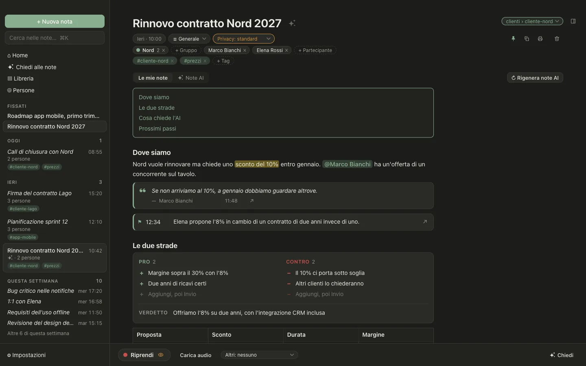
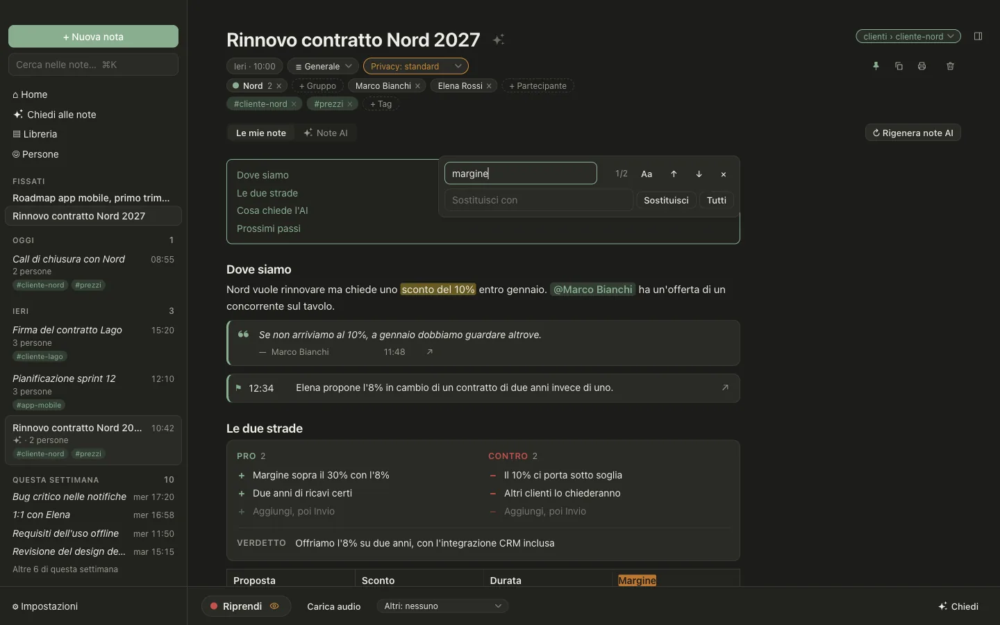

Le note si scrivono in un editor Markdown e si salvano mentre scrivi. Digita `/` per il [menu dei comandi](/it/reference/slash-commands/); seleziona del testo per la barra di formattazione.

## Blocchi

Tutto viene salvato come Markdown leggibile, così le tue note restano tue anche fuori da Granello.

| Blocco | Come si inserisce | In Markdown |
| --- | --- | --- |
| Tabella | `\|` + spazio | una tabella Markdown |
| Riquadro | `!` + spazio | `> [!NOTE]`, `> [!WARNING]`, `> [!DECISION]` |
| Sezione richiudibile | menu `/` | `::: details Titolo` … `:::` |
| Colonne | menu `/` | `:::: columns` con un `::: column` ciascuna |
| Immagine, allegato | incolla, trascina o menu `/` | `` |
| Anteprima di un link | menu `/` | `[Titolo](https://… "preview")` |
| Formula | `$x^2$`, `$$` + spazio | `$…$`, `$$` … `$$` |
| Indice | menu `/` | `[[toc]]` |
| Evidenziatore | ⌘⇧H | `==testo==` |
| Persona | `@` | `@[Nome]` |
| Data | menu `/` | `[[2026-11-26]]` |
| Sondaggio | menu `/` | `::: poll Domanda` |
| Kanban | menu `/` | `::: kanban` |
| Linea del tempo | menu `/` | `::: timeline` |
| Pro e contro | menu `/` | `::: pros-cons` |
| Matrice di decisione | menu `/` | `::: matrix` attorno a una tabella |
| Valutazione a stelle | menu `/` | `[[rating:4]]` |
| Timer | menu `/` | `[[timer:05:00]]` |
| Barra di avanzamento | menu `/` | `[[progress]]` |
| Grafico | menu `/` | `[[chart:bar]]`, `[[chart:line]]` |
| Diagramma | menu `/` | un blocco di codice `mermaid` |
| Lavagna | menu `/` | un blocco di codice `sketch` |
| Contenuto incorporato | menu `/` | `[Titolo](https://… "embed")` |
| Blocco AI dal vivo | menu `/` | `::: ai Richiesta` … `:::` |
| Citazione dalla trascrizione | seleziona il testo nella trascrizione | `::: quote 12:34 Nome` … `:::` |
| Momento segnato | ⇧⌘M mentre registri | `::: moment 12:34` … `:::` |

## Citazioni dalla trascrizione

Seleziona una frase nel pannello Trascrizione e premi **❝ Cita**. Nella nota compare una citazione con chi l'ha detta e il minuto; ↗ sulla citazione riapre la trascrizione in quel punto. Mentre registri, **❝ Cita** in fondo al pannello cita l'ultima frase trascritta senza selezionare niente. Dal menu `/` la citazione è vuota, al minuto attuale della registrazione.

## Trova e sostituisci

⌘F apre trova e sostituisci dentro una nota. Le corrispondenze sono evidenziate, Invio e Maiusc Invio passano dall'una all'altra, e **Tutti** le sostituisce tutte con un solo Annulla. Cerca nel testo della nota; i blocchi fatti di dati (sondaggi, kanban, citazioni) restano fuori.

## Copiare, stampare, eliminare

Le tre icone in alto a destra di una nota la copiano come Markdown, la stampano (o la salvano in PDF) e la eliminano.

## L'AI nell'editor

- Un **blocco AI dal vivo** contiene una richiesta, per esempio "riassumi le obiezioni del cliente", e la sua risposta. La risposta viene ricalcolata mentre registri e un'ultima volta a fine trascrizione.
- **✦** su un sondaggio, un kanban, una linea del tempo, pro e contro, una matrice di decisione o un diagramma crea o modifica il blocco da una richiesta.
- **✦** sul testo selezionato lo riscrive: accorcia, traduci, espandi.
- **✦** accanto al titolo propone un titolo da note e trascrizione.

Ognuna di queste funzioni invia le note e la trascrizione al provider AI che hai configurato. Vedi [livelli di privacy](/it/privacy/levels/) per le note in cui questo non deve succedere.
