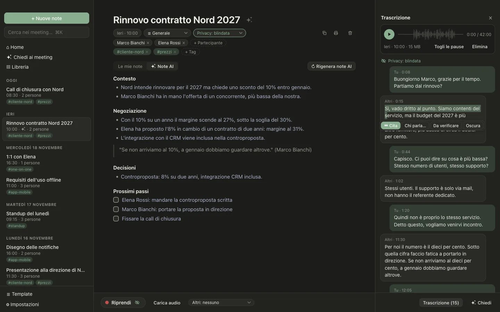
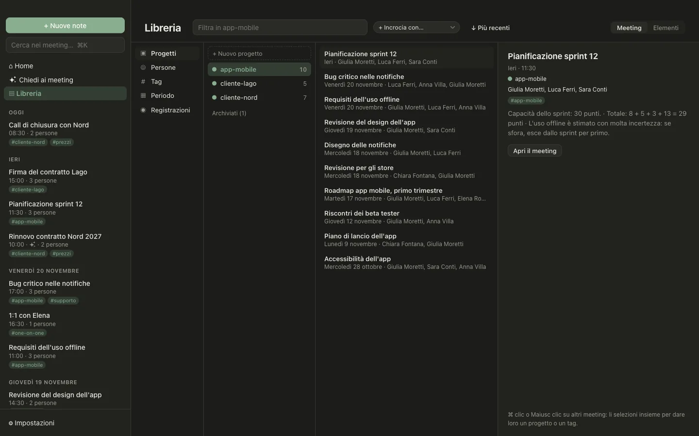

import { Card, CardGrid, LinkCard } from "@astrojs/starlight/components";

## La privacy è il prodotto

<CardGrid>
  <Card title="Trascritto sul tuo Mac" icon="laptop">
    Il parlato diventa testo sul tuo Mac, con whisper.cpp. Di norma l'audio viene trascritto e scartato: non
    viene salvato né caricato.
  </Card>
  <Card title="Un livello di privacy per meeting" icon="approve-check-circle">
    Standard, audio locale o blindata. Con blindata non esce niente dal Mac: le funzioni AI usano un modello
    locale, oppure non sono disponibili.
  </Card>
  <Card title="Oscura e verifica" icon="pencil">
    Seleziona una frase nella trascrizione e oscurala per sempre, oppure segnala da verificare. Un meeting con
    parti da verificare non viene inviato a modelli online.
  </Card>
  <Card title="Nessun bot nella call" icon="seti:audio">
    Granello ascolta il tuo microfono e quello che il computer riproduce. Niente entra nella riunione, e gli
    altri partecipanti non vedono niente di nuovo.
  </Card>
  <Card title="I tuoi modelli, le tue chiavi" icon="setting">
    Le note AI usano il provider che scegli tu, con la tua API key nel Portachiavi. Con un provider locale non
    esce niente dal tuo Mac.
  </Card>
  <Card title="Codice aperto" icon="github">
    Il codice è pubblico con licenza MIT: quello che Granello fa con i tuoi meeting si può leggere, non solo
    promettere.
  </Card>
</CardGrid>

## Cosa fa

- **Durante il meeting** scrivi poche righe. Granello registra, mostra i livelli dell'audio e ti fa segnare un momento con un tasto.
- **Dopo**, un modello AI unisce i tuoi appunti e la trascrizione in note complete, seguendo il template che scegli.
- **Più avanti**, la Libreria ritrova i meeting per progetto, persona, tag e periodo, ed elenca le decisioni e le azioni scritte nelle note.

[Scarica Granello](/it/start/install/) per i Mac con Apple Silicon.

## Documentazione

<CardGrid>
  <LinkCard title="Per cominciare" description="Installa Granello e registra il tuo primo meeting." href="/it/start/install/" />
  <LinkCard title="Privacy" description="Cosa resta sul tuo Mac, i livelli di privacy, l'oscuramento e i modelli locali." href="/it/privacy/overview/" />
  <LinkCard title="Guide" description="Registrazione, note, note AI e template, la Libreria." href="/it/guides/recording/" />
  <LinkCard title="Comandi /" description="Ogni blocco del menu /, con cosa fa e come si scrive in Markdown." href="/it/reference/slash-commands/" />
</CardGrid>
