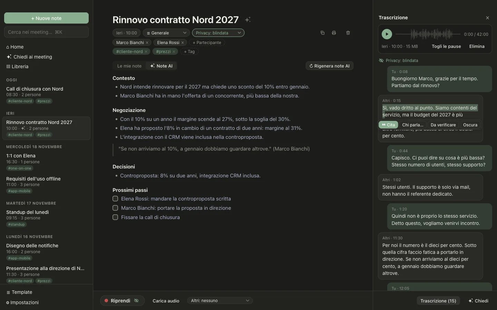

Ogni meeting ha un livello di **Privacy**, scelto nell'intestazione del meeting. Vale solo per quel meeting e ha la precedenza sulle impostazioni generali.

| Livello | Audio | Testo inviato a un provider AI |
| --- | --- | --- |
| **Standard** | Segue le impostazioni: trascrizione locale, più quella online se l'hai attivata | Sì, al provider che hai configurato |
| **Audio locale** | Elaborato solo su questo Mac: niente trascrizione online | Sì, al provider che hai configurato |
| **Blindata** | Elaborato solo su questo Mac | No. Si usa solo un modello servito da questo Mac |

## Blindata

Con **blindata** non esce niente del meeting dal Mac. Note AI, chat, funzioni AI dell'editor e generazione del titolo usano solo un provider su `localhost`. Se non c'è un modello locale configurato, quelle funzioni non sono disponibili per quel meeting, e Granello lo dice invece di ripiegare su un modello online.

## L'occhio

Il livello si vede sempre, come un occhio sul pulsante **Registra** e in cima alla trascrizione:

- un occhio **aperto** è standard,
- un occhio **socchiuso** è audio locale,
- un occhio **barrato** è blindata.

## Copiare e stampare

Copiare una nota come Markdown e stamparla portano il testo fuori da Granello. Per un meeting blindato, o con parti da verificare, il primo clic avvisa e il secondo procede.

## Da sapere

- Puoi cambiare livello in qualsiasi momento. Vale da lì in poi: quello che è già stato inviato non torna indietro.
- La chat su tutti i meeting lascia fuori quelli che non possono andare al modello in uso.
