Digita `/` in una nota per aprire il menu dei comandi. Continua a scrivere per filtrarlo (capisce parole italiane e inglesi: `/tabella` e `/table` vanno bene tutte e due), spostati con le frecce, inserisci con Invio, chiudi con Esc. Dentro il codice il menu non si apre. Il nome di un gruppo mostra tutto il gruppo: `/meeting` elenca tutti i blocchi del gruppo Meeting, `/strumenti` tutti gli strumenti.

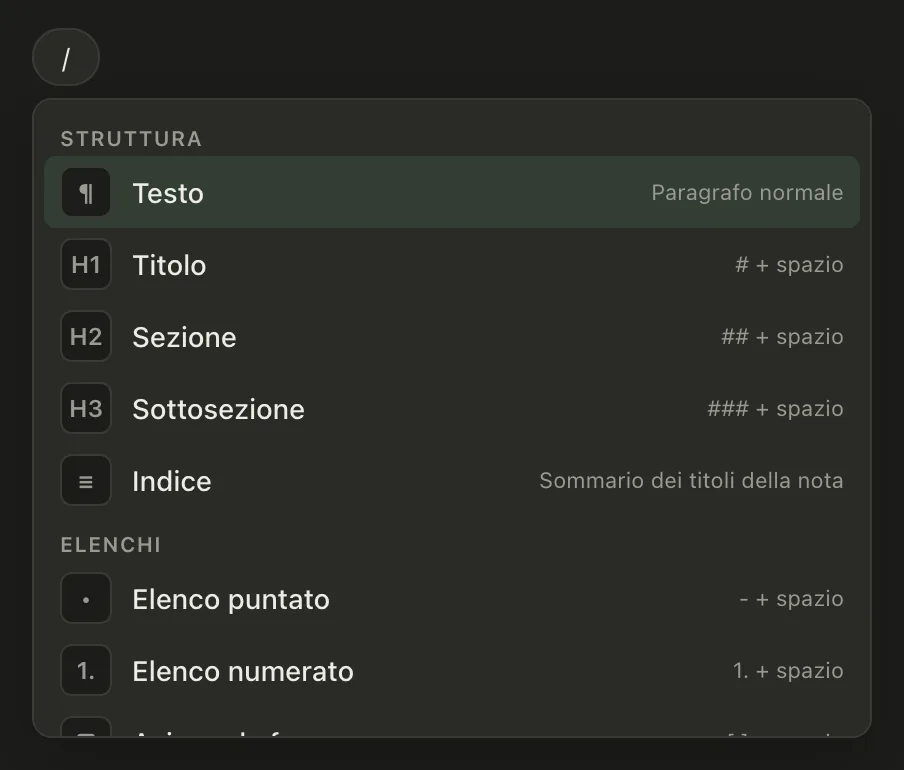

Tutto quello che un comando inserisce si salva come Markdown leggibile: per ogni comando qui sotto c'è come. Diversi blocchi hanno una scorciatoia da digitare al posto del menu.

Con il cursore dentro una tabella, il menu comincia con i comandi della tabella: **Aggiungi riga sopra**, **Aggiungi riga sotto**, **Aggiungi colonna a sinistra**, **Aggiungi colonna a destra**, **Elimina riga**, **Elimina colonna**, **Elimina tabella**. Dentro un blocco di colonne comincia con i comandi delle colonne: **Aggiungi colonna a sinistra**, **Aggiungi colonna a destra**, **Elimina colonna**, **Togli le colonne, tieni il testo**, **Elimina tutto il blocco**.

## Struttura

### Testo

Un paragrafo normale. Serve a riportare a testo normale un titolo o una voce di elenco.

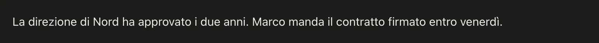

### Titolo

Il titolo più grande, di solito uno per nota.

Scorciatoia: `#` + spazio. Markdown: `# Titolo`.


### Sezione

Il titolo di una parte della nota. Le sezioni sono quello che elenca l'[indice](#indice) e quello in cui conta l'[avanzamento](#avanzamento).

Scorciatoia: `##` + spazio. Markdown: `## Sezione`.

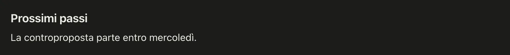

### Sottosezione

Un titolo dentro una sezione.

Scorciatoia: `###` + spazio. Markdown: `### Sottosezione`.


### Indice

Il sommario dei titoli della nota, che si aggiorna mentre scrivi. Un clic su un titolo ci porta lì.

Markdown: `[[toc]]`.

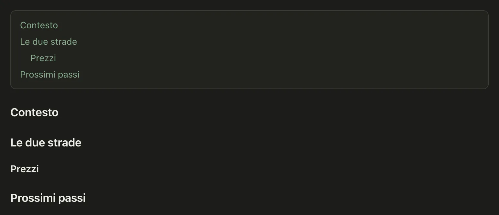

## Elenchi

### Elenco puntato

Scorciatoia: `-` + spazio. Markdown: `- voce`.

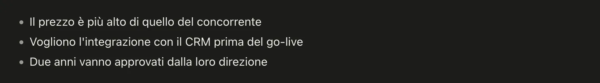

### Elenco numerato

Scorciatoia: `1.` + spazio. Markdown: `1. voce`.

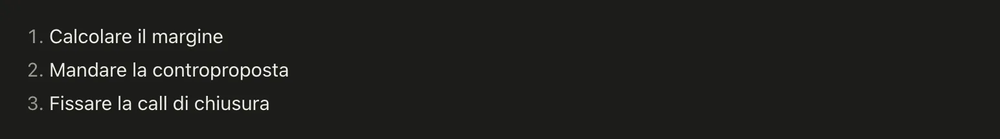

### Azione da fare

Una casella da spuntare quando la cosa è fatta. Le azioni di tutti i meeting si trovano insieme nella [Libreria](/it/guides/library/#elementi-attraverso-i-meeting), e l'[avanzamento](#avanzamento) le conta.

Scorciatoia: `[ ]` + spazio. Markdown: `- [ ] da fare`, `- [x] fatto`.

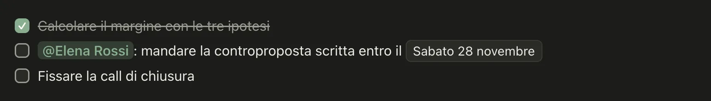

## Blocchi

### Citazione

Una citazione che non viene dalla trascrizione, per esempio da una mail. Per una frase detta nel meeting c'è la [citazione dalla trascrizione](#citazione-dalla-trascrizione).

Scorciatoia: `>` + spazio. Markdown: `> testo`.

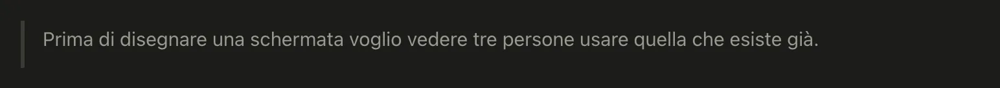

### Blocco di codice

Testo mostrato così com'è, con un carattere a spaziatura fissa.

Scorciatoia: ```` ``` ```` + spazio. Markdown: un blocco di codice tra tre apici inversi.

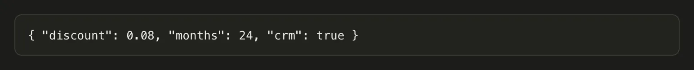

### Separatore

Una linea orizzontale tra due parti della nota.

Scorciatoia: `---` + Invio. Markdown: `---`.

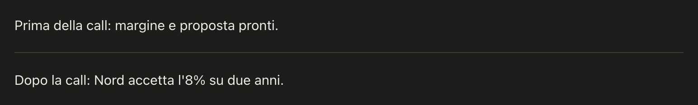

### Tabella

Una tabella con una riga di intestazione. Tab passa alla cella dopo, Invio a quella sotto; nell'ultima riga Invio ne aggiunge una.

Con il puntatore o il cursore su una cella compaiono due maniglie, una a sinistra della riga e una sopra la colonna: aprono un menu per aggiungere una riga o una colonna accanto, eliminarla, o eliminare la tabella. Le barre **+** sotto e a destra della tabella aggiungono una riga o una colonna in fondo. Le stesse azioni sono nel menu `/`.

Cancella (⌫) in una riga vuota la toglie, e in una tabella tutta vuota toglie la tabella. All'inizio del paragrafo dopo la tabella, Cancella seleziona la tabella: premilo ancora per eliminarla.

Scorciatoia: `|` + spazio. Markdown: una tabella Markdown.

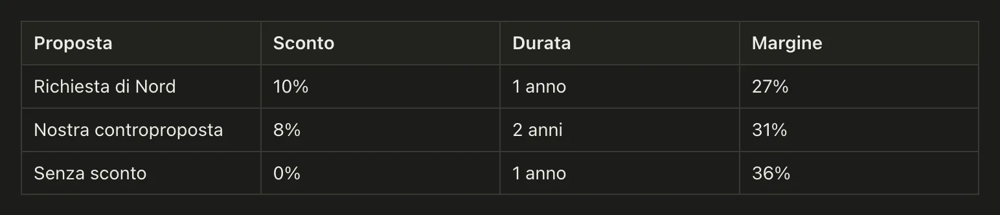

### Sezione richiudibile

Un titolo con un contenuto che si apre con un clic, per i dettagli che non servono sempre. Quando riapri la nota le sezioni sono chiuse.

Markdown: `::: details Titolo` … `:::`.


### Due colonne

Due blocchi affiancati.

Ogni colonna ha una maniglia in alto a sinistra: apre un menu per aggiungere una colonna accanto (fino a tre), eliminare la colonna, togliere le colonne tenendo il testo, o eliminare tutto il blocco. Le stesse azioni sono nel menu `/`.

Cancella (⌫) in una colonna vuota la toglie; con due colonne resta il testo dell'altra. All'inizio del paragrafo dopo le colonne, Cancella seleziona il blocco: premilo ancora per eliminarlo.

Markdown: `:::: columns`, con un `::: column` … `:::` per colonna.

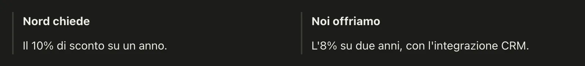

### Tre colonne

Tre blocchi affiancati, scritti come le due colonne con un `::: column` in più.

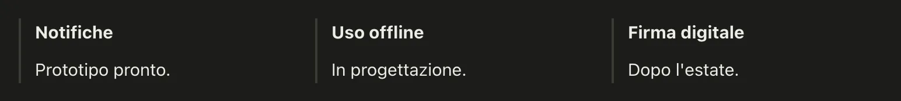

### Formula

Una formula dentro una frase, scritta in LaTeX.

Markdown: `$…$`.


### Formula a blocco

Una formula su una riga a sé, centrata.

Scorciatoia: `$$` + spazio. Markdown: `$$` … `$$`.


## Riquadri

### Nota in evidenza

Un riquadro che si stacca dal testo, per qualcosa da non perdere.

Scorciatoia: `!` + spazio. Markdown: `> [!NOTE]`.

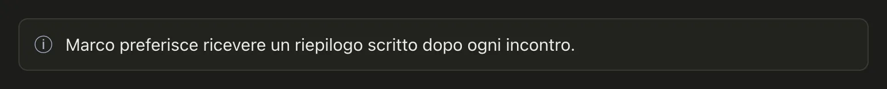

### Attenzione

Un riquadro per un rischio o un punto critico.

Markdown: `> [!WARNING]`.

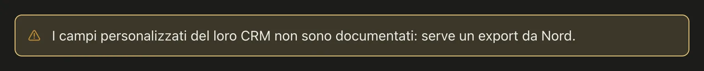

### Riquadro decisione

Un riquadro per una decisione. I riquadri decisione di tutti i meeting si trovano insieme nella [Libreria](/it/guides/library/#elementi-attraverso-i-meeting).

Markdown: `> [!DECISION]`.

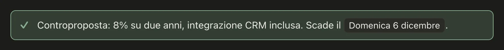

## Allegati e link

### Immagine

Scegli un file immagine: viene copiato negli allegati del meeting. Puoi anche incollare uno screenshot o trascinare un'immagine nella nota.

Markdown: ``.


### Allegato

Scegli un file qualsiasi, fino a 25 MB: viene copiato negli allegati del meeting e mostrato con nome e dimensione.

Markdown: `[📎 nome (dimensione)](attachments/…)`.

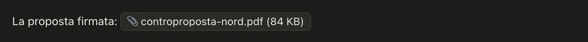

### Anteprima link

Incolla un link e premi Invio: il link diventa una scheda con il titolo della pagina e il sito. Il titolo viene chiesto alla pagina una volta sola, quando si crea la scheda.

Markdown: `[Titolo](https://… "preview")`.

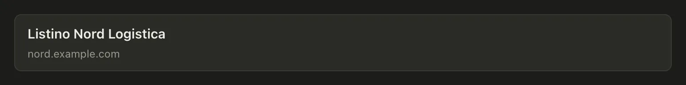

### Incorpora

Un link di YouTube, Loom, Vimeo o Figma, o una mappa, visibile dentro la nota. Non si carica niente finché non fai clic: aprire la nota non contatta nessun sito.

Markdown: `[Titolo](https://… "embed")`.

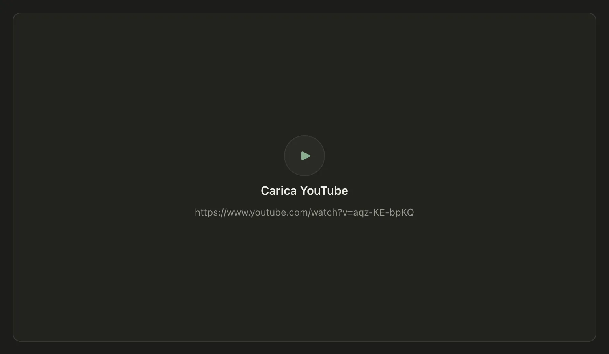

## Meeting

### Decisione

Comincia una riga con **Decisione:** in grassetto, per scrivere una decisione mentre prendi appunti. Perché compaia nella Libreria, usa un [riquadro decisione](#riquadro-decisione).

Markdown: `**Decisione:** …`.


### Domanda aperta

Comincia una riga con **Da chiarire:** in grassetto, per qualcosa da sistemare dopo.

Markdown: `**Da chiarire:** …`.


### Ora attuale

Scrive l'ora, per esempio `10:42`, come testo normale.


### Segna il momento

Segna il minuto della registrazione, come ⇧⌘M mentre registri. Quando il meeting finisce, l'AI scrive cosa si stava dicendo in quel minuto; puoi anche scriverlo tu. ↗ apre la trascrizione in quel punto.

Markdown: `::: moment 12:34` … `:::`.

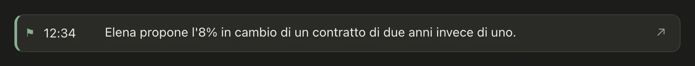

### Citazione dalla trascrizione

Una frase detta nel meeting, con chi l'ha detta e il minuto. Il modo più veloce è selezionare il testo nel pannello Trascrizione e premere **❝ Cita**; il comando ne inserisce una vuota da compilare. Le citazioni si trovano nella [Libreria](/it/guides/library/#elementi-attraverso-i-meeting).

Markdown: `::: quote 12:34 Nome` … `:::`.

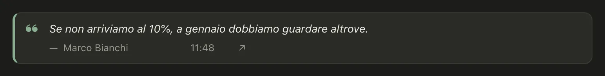

### Chiedi all'AI

Una richiesta sul meeting, come "Quali sono le obiezioni del cliente?", con la risposta sotto. La risposta si ricalcola mentre registri e un'ultima volta quando la trascrizione finisce; ↻ la richiede. Invia le note e la trascrizione al provider AI che hai configurato: vedi [livelli di privacy](/it/privacy/levels/) per i meeting in cui questo non deve succedere.

Markdown: `::: ai Richiesta` … `:::`.

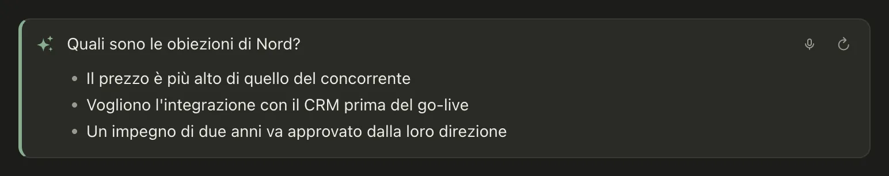

## Strumenti

Sondaggi, lavagne a colonne, timeline, pro e contro, matrici di decisione e diagrammi hanno un pulsante **✦** che crea o modifica il blocco da una richiesta scritta con parole tue. Come ogni funzione AI, invia le note e la trascrizione al tuo provider.

### Sondaggio

Una domanda con le opzioni e i voti, per contare in fretta durante il meeting. − e + cambiano i voti; l'opzione in testa è evidenziata.

Markdown: `::: poll Domanda`, poi `- [voti] opzione` per ogni opzione, poi `:::`.

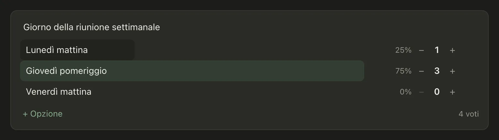

### Lavagna a colonne

Colonne di schede, all'inizio Da fare, In corso e Fatto. Trascina una scheda in un'altra colonna, o spostala con le frecce; i nomi delle colonne si possono cambiare.

Markdown: `::: kanban`, un titolo `## Colonna` per colonna e un `- scheda` per scheda, poi `:::`.

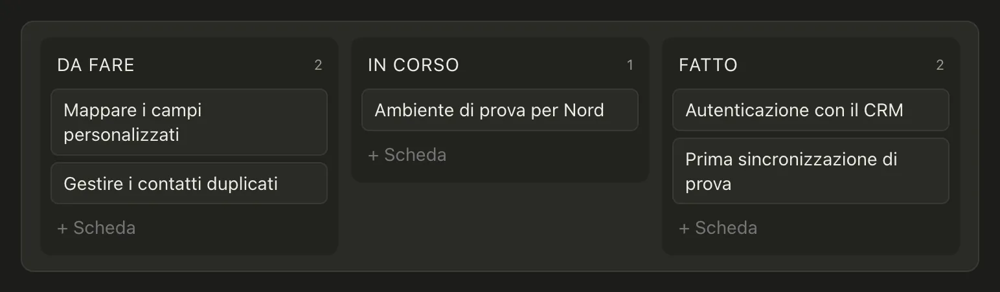

### Timeline

Tappe con le loro date, in ordine lungo una linea. Le tappe passate sono attenuate e la prossima è evidenziata. In fondo se ne aggiunge una con la sua data.

Markdown: `::: timeline`, poi `- 2026-12-10 Tappa` per ogni tappa, poi `:::`.

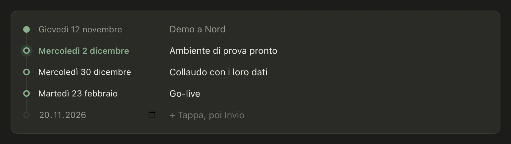

### Pro e contro

Due colonne, pro e contro, e sotto un verdetto.

Markdown: `::: pros-cons`, poi righe `+ pro`, `- contro` e `= verdetto`, poi `:::`.

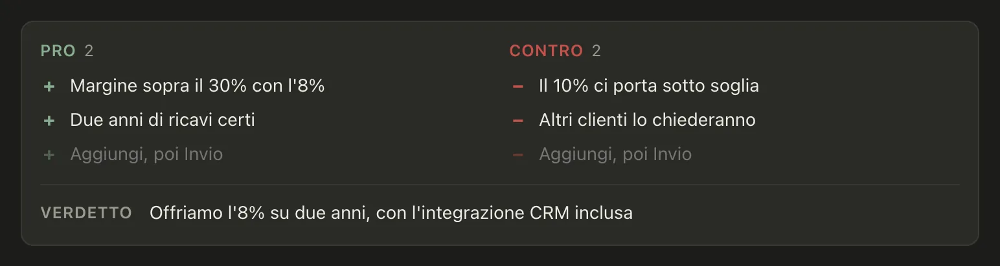

### Matrice di decisione

Opzioni a confronto su criteri pesati. Il totale di ogni opzione è la somma di peso × punteggio, e il totale più alto è evidenziato. **+ Criterio** e **+ Opzione** aggiungono righe e colonne.

Markdown: una tabella dentro `::: matrix` … `:::`, con i criteri nella prima colonna e i pesi nella seconda.

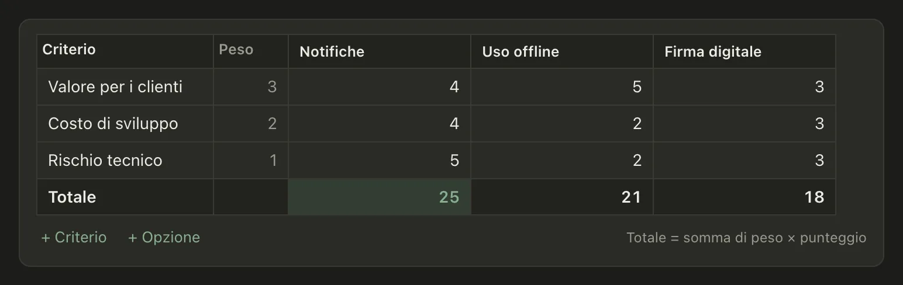

### Valutazione

Da una a cinque stelle dentro una frase. Un clic su una stella la cambia.

Markdown: `[[rating:4]]`.


### Timer

Un conto alla rovescia per un punto all'ordine del giorno, all'inizio di cinque minuti: scrivi un'altra durata in minuti, o minuti:secondi. Avvialo, mettilo in pausa, azzeralo; una notifica dice quando il tempo è scaduto. Si salva solo la durata: riaprendo la nota il timer è fermo e pronto.

Markdown: `[[timer:05:00]]`.


### Avanzamento

Una barra con quante azioni da fare della sua sezione sono fatte: dal titolo che la precede fino al prossimo titolo dello stesso livello. Senza un titolo prima, conta tutta la nota. Non salva numeri: conta le caselle ogni volta.

Markdown: `[[progress]]`.

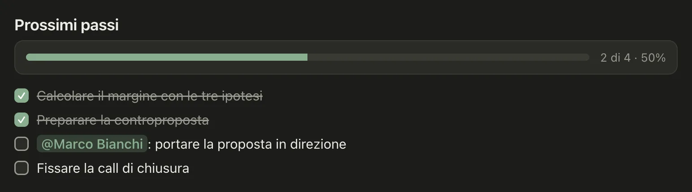

### Grafico

Disegna la tabella più vicina sopra di lui: la prima colonna dà le etichette, le altre i numeri. Il grafico segue la tabella mentre la modifichi, e passa da barre a linee.

Markdown: `[[chart:bar]]` o `[[chart:line]]`; i dati restano nella tabella.

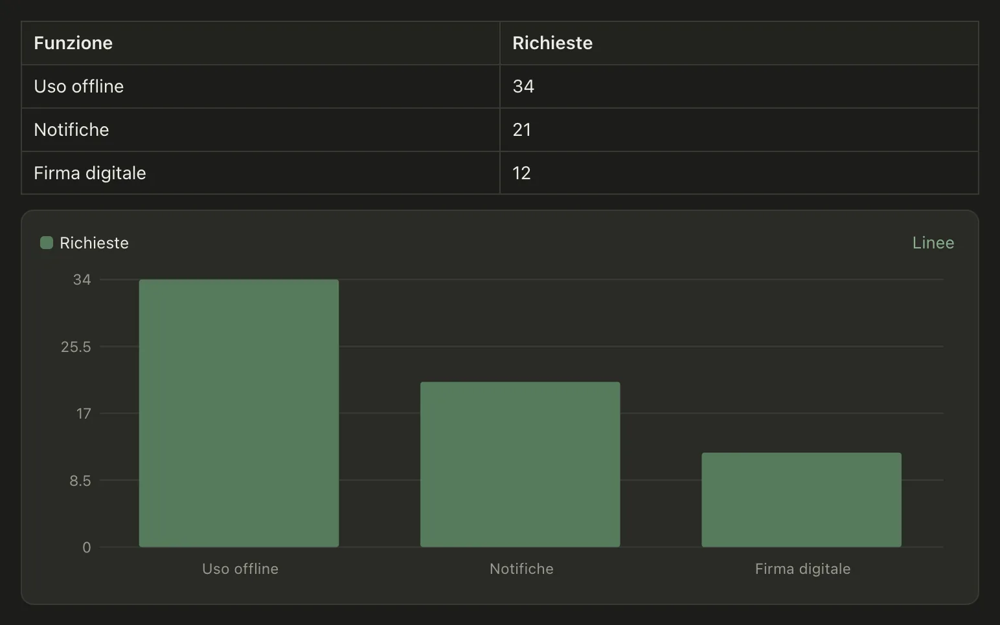

### Diagramma

Flussi e sequenze scritti come testo in [Mermaid](https://mermaid.js.org/) e disegnati nella nota. **Modifica il diagramma** mostra il testo.

Markdown: un blocco di codice `mermaid`.

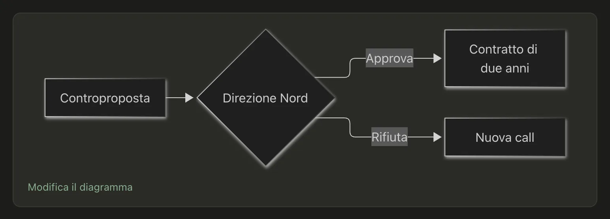

### Lavagna

Uno schizzo a mano libera, in quattro colori. **✦ In diagramma** fa leggere lo schizzo all'AI e mette sotto la lavagna un diagramma Mermaid.

Markdown: un blocco di codice `sketch`: le dimensioni, poi una riga per ogni tratto.

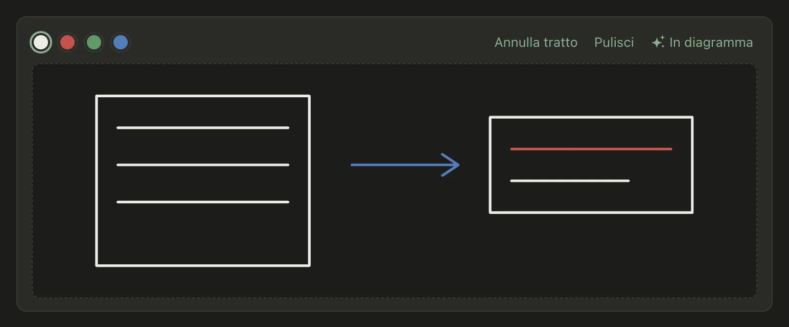

## Persone e date

### Persona

Cita una persona: scrivi un nome e scegli tra i tuoi contatti e le persone del calendario, oppure usa un nome nuovo così com'è. Il tasto `@` apre lo stesso elenco.

Markdown: `@[Nome Cognome]`.

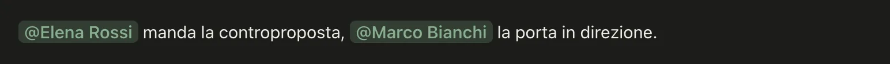

### Data di oggi

Inserisce la data di oggi come data, che si legge "Oggi" o come giorno della settimana e del mese. Un clic sulla data ne sceglie un'altra.

Markdown: `[[2026-11-26]]`.

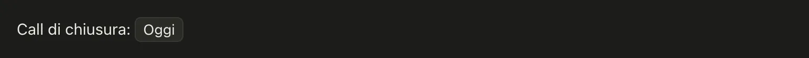

### Data di domani

Lo stesso, con la data di domani.

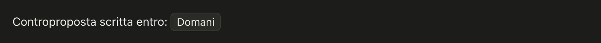
