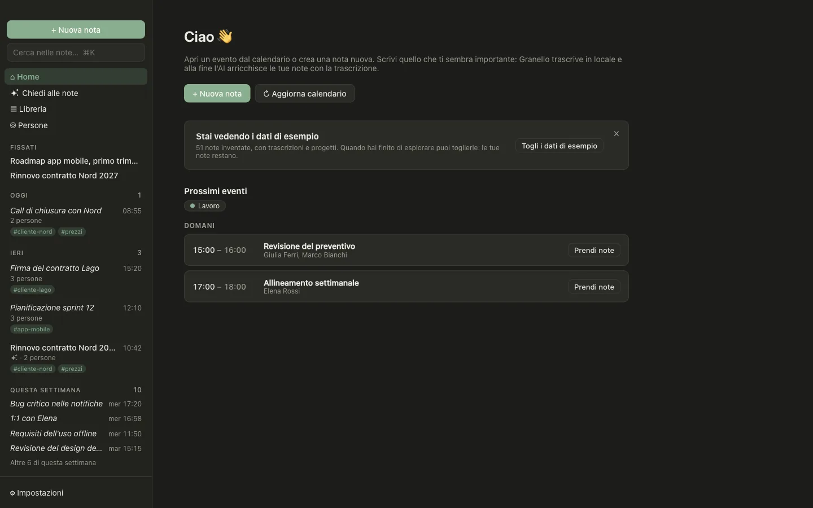
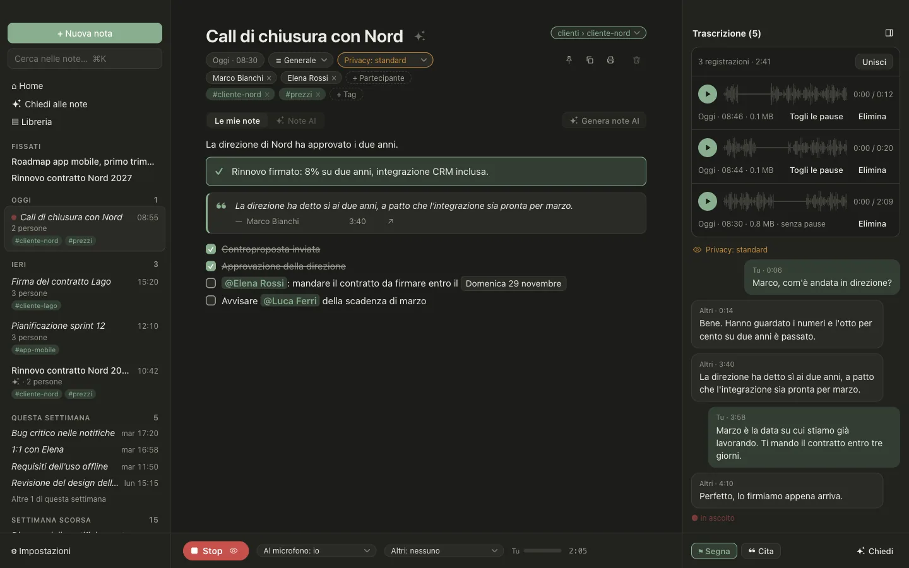
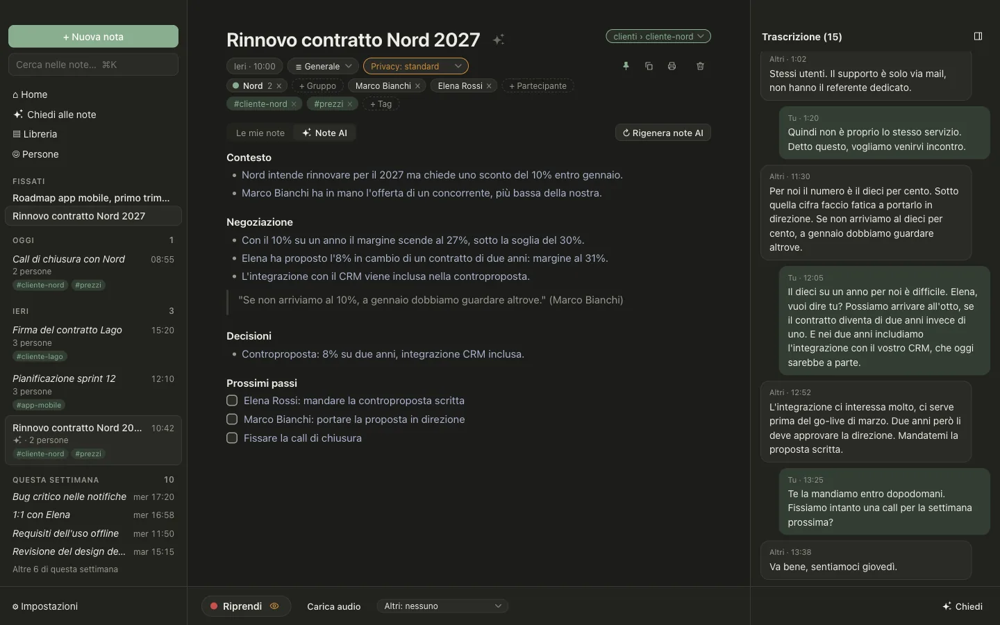

Dopo il primo avvio la Home mostra cosa manca. Le cose da impostare sono tre, tutte nelle **Impostazioni**.

## Impostare

1. **Trascrizione locale**: scarica un modello whisper. `large-v3-turbo-q5_0` (547 MB) è quello consigliato su Apple Silicon; `base` basta per una prova veloce.
2. **Modelli AI**: incolla l'API key del tuo provider, oppure aggiungi un provider locale. La chiave va nel Portachiavi di macOS. Vedi [modelli locali](/it/privacy/local-models/) per tenere tutto sul Mac.
3. **Calendario** (facoltativo): aggiungi un calendario incollando il suo indirizzo iCal segreto. I prossimi eventi compaiono in Home, con un clic per aprire le loro note.

Per dare prima un'occhiata, **Carica i dati di esempio** in Home riempie l'app con 50 meeting inventati. Si tolgono con un clic e non toccano mai i tuoi meeting. Se la scheda non ti serve, chiudila con la ×: i dati di esempio restano in Impostazioni → Dati e privacy.

## Registrare

1. Premi **Nuove note** (⌘N), oppure **Prendi note** su un evento del calendario.
2. Scegli il livello di **Privacy** del meeting nell'intestazione, se non deve essere quello standard. Vedi [livelli di privacy](/it/privacy/levels/).
3. Premi **Registra**. La prima volta macOS chiede il permesso di usare il microfono.
4. Scrivi le poche cose che contano per te. Premi **⚑ Segna** (⇧⌘M) quando si dice qualcosa di importante: la nota tiene il minuto.
5. Premi **Stop**.

## Ottenere le note

Apri **Trascrizione** per leggere quello che è stato detto, con chi parla e il minuto. Poi premi **Genera note AI**: il modello unisce i tuoi appunti e la trascrizione in note complete, seguendo il template del meeting. Le note AI restano modificabili, e le tue note restano nella loro scheda.

Poi: [come funziona la privacy](/it/privacy/overview/).
