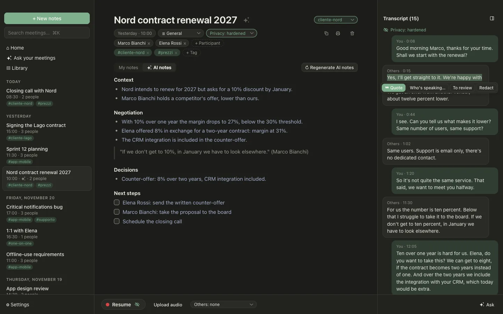

Each meeting has a **Privacy** level, chosen in the meeting's header. It overrides the general settings for that meeting only.

| Level | Audio | Text sent to an AI provider |
| --- | --- | --- |
| **Standard** | Follows the settings: local transcription, plus online transcription if you turned it on | Yes, to the provider you configured |
| **Local audio** | Processed only on this Mac: no online transcription | Yes, to the provider you configured |
| **Hardened** | Processed only on this Mac | No. Only a model served on this Mac is used |

## Hardened

With **hardened**, nothing of the meeting leaves the Mac. AI notes, the chat, the AI features of the editor and the title generation use only a provider on `localhost`. If no local model is configured, those features are not available for that meeting, and Granello says so instead of falling back to an online model.

## The eye

The level is always visible, as an eye on the **Record** button and at the top of the transcript:

- an **open** eye is standard,
- a **half-closed** eye is local audio,
- a **crossed-out** eye is hardened.

## Copying and printing

Copying a note as Markdown and printing it take the text out of Granello. For a hardened meeting, or one with parts to review, the first click warns you and the second one goes ahead.

## Good to know

- You can change the level at any time. It applies from then on: what was already sent is not taken back.
- The chat across all meetings leaves out the meetings that may not go to the model in use.
