Type `/` in a note to open the command menu. Keep typing to filter it (it understands English and Italian words, so `/table` and `/tabella` both work), move with the arrows, insert with Enter, close with Esc. The menu does not open inside code. The name of a group shows the whole group: `/meeting` lists every block of the Meeting group, `/tools` every tool.

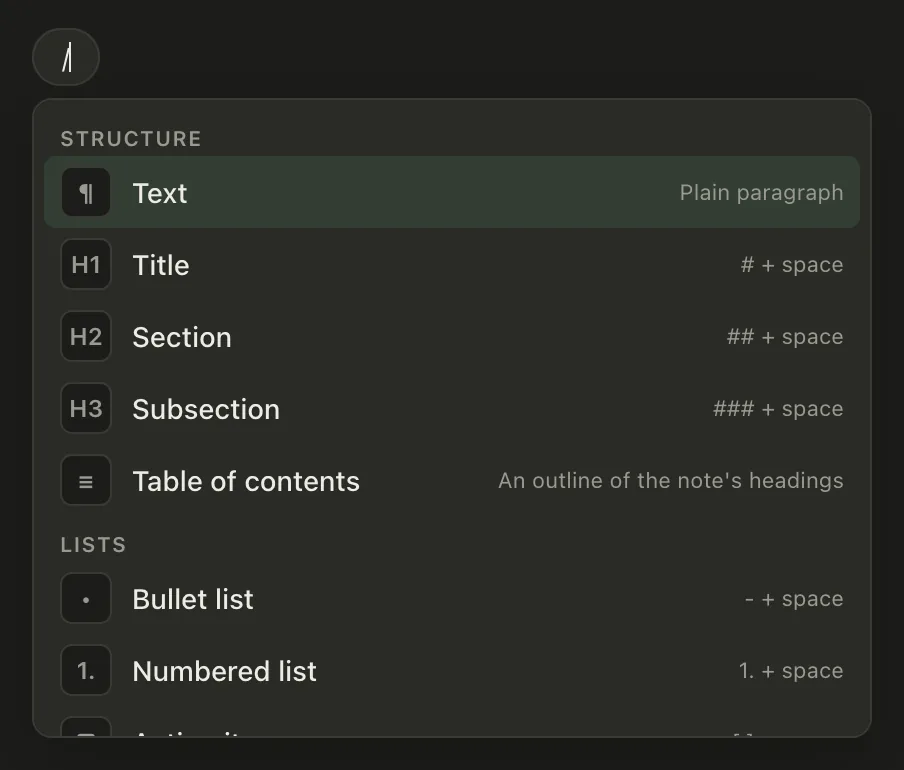

Everything a command inserts is saved as readable Markdown: each command below shows how. Several blocks have a shortcut you can type instead of opening the menu.

With the cursor inside a table, the menu starts with the table's own commands: **Add row above**, **Add row below**, **Add column to the left**, **Add column to the right**, **Delete row**, **Delete column**, **Delete table**. Inside a columns block it starts with the columns' commands: **Add column to the left**, **Add column to the right**, **Delete column**, **Remove the columns, keep the text**, **Delete the whole block**.

## Structure

### Text

A plain paragraph. Use it to turn a heading or a list item back into normal text.


### Title

The largest heading, usually one per note.

Shortcut: `#` + space. Markdown: `# Title`.


### Section

A heading for a part of the note. Sections are what the [table of contents](#table-of-contents) lists and what [progress](#progress) counts in.

Shortcut: `##` + space. Markdown: `## Section`.


### Subsection

A heading inside a section.

Shortcut: `###` + space. Markdown: `### Subsection`.


### Table of contents

An outline of the note's headings that updates as you write. Click a heading in it to jump there.

Markdown: `[[toc]]`.

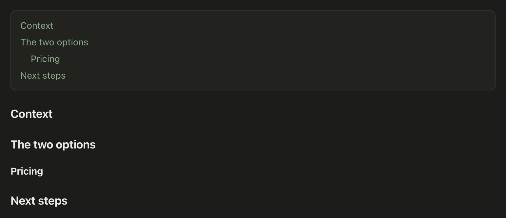

## Lists

### Bullet list

Shortcut: `-` + space. Markdown: `- item`.

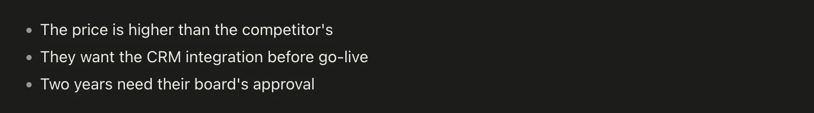

### Numbered list

Shortcut: `1.` + space. Markdown: `1. item`.

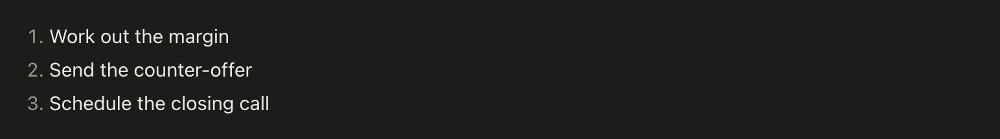

### Action item

A checkbox to tick when the thing is done. Action items from every meeting are listed together in the [Library](/guides/library/#items-across-meetings), and [progress](#progress) counts them.

Shortcut: `[ ]` + space. Markdown: `- [ ] to do`, `- [x] done`.

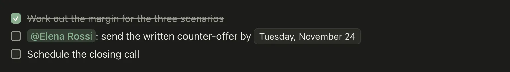

## Blocks

### Quote

A quote that is not from the transcript, for example from an email. For something said in the meeting use a [transcript quote](#transcript-quote).

Shortcut: `>` + space. Markdown: `> text`.


### Code block

Text shown as it is, in a monospaced font.

Shortcut: ```` ``` ```` + space. Markdown: a fenced code block.

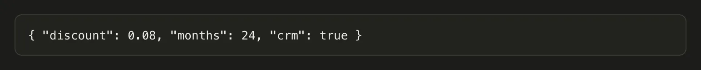

### Divider

A horizontal line between two parts of the note.

Shortcut: `---` + Enter. Markdown: `---`.

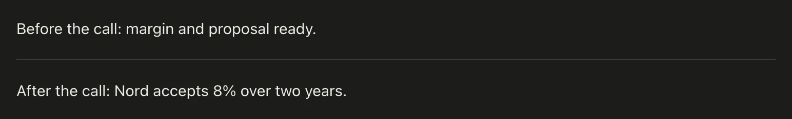

### Table

A table with a header row. Tab moves to the next cell, Enter to the one below; in the last row Enter adds a new one.

With the pointer or the cursor on a cell, two handles appear, one to the left of the row and one above the column: each opens a menu to add a row or a column next to it, delete it, or delete the table. The **+** bars below and to the right of the table add a row or a column at the end. The same actions are in the `/` menu.

Backspace in an empty row removes it, and in a table that is completely empty removes the table. At the start of the paragraph after the table, Backspace selects the table: press it again to delete it.

Shortcut: `|` + space. Markdown: a Markdown table.

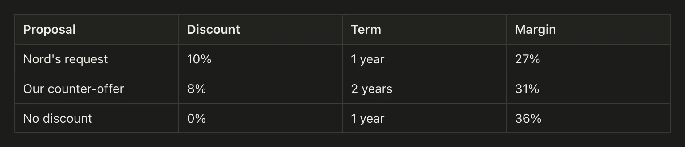

### Collapsible section

A title with content that opens on click, for details that are not needed every time. Sections are closed when you reopen the note.

Markdown: `::: details Title` … `:::`.

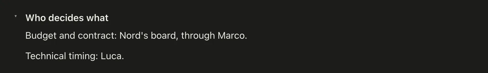

### Two columns

Two blocks side by side.

Each column has a handle at its top left: it opens a menu to add a column next to it (up to three), delete the column, remove the columns while keeping the text, or delete the whole block. The same actions are in the `/` menu.

Backspace in an empty column removes it; with two columns the text of the other one stays. At the start of the paragraph after the columns, Backspace selects the block: press it again to delete it.

Markdown: `:::: columns`, with a `::: column` … `:::` for each column.

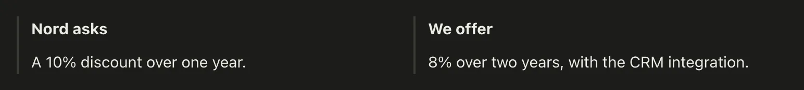

### Three columns

Three blocks side by side, written like two columns with one more `::: column`.

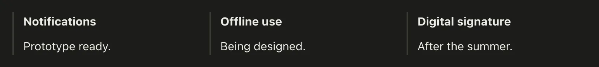

### Formula

A formula inside a sentence, written in LaTeX.

Markdown: `$…$`.


### Block formula

A formula on its own line, centred.

Shortcut: `$$` + space. Markdown: `$$` … `$$`.


## Callouts

### Highlighted note

A box that stands out from the text, for something not to miss.

Shortcut: `!` + space. Markdown: `> [!NOTE]`.

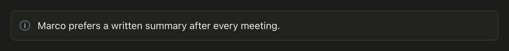

### Warning

A box for a risk or a critical point.

Markdown: `> [!WARNING]`.


### Decision callout

A box for a decision. Decision callouts from every meeting are listed together in the [Library](/guides/library/#items-across-meetings).

Markdown: `> [!DECISION]`.

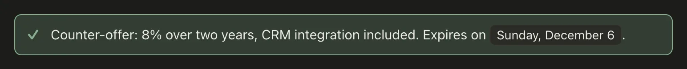

## Attachments and links

### Image

Choose an image file; it is copied into the meeting's attachments. You can also paste a screenshot or drop an image into the note.

Markdown: ``.


### Attachment

Choose any file, up to 25 MB; it is copied into the meeting's attachments and shown with its name and size.

Markdown: `[📎 name (size)](attachments/…)`.


### Link preview

Paste a link and press Enter: the link becomes a card with the page title and the site. The title is asked of the page once, when the card is created.

Markdown: `[Title](https://… "preview")`.

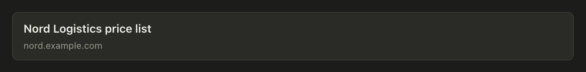

### Embed

A YouTube, Loom, Vimeo or Figma link, or a map, shown inside the note. Nothing is loaded until you click it: opening the note does not contact any site.

Markdown: `[Title](https://… "embed")`.

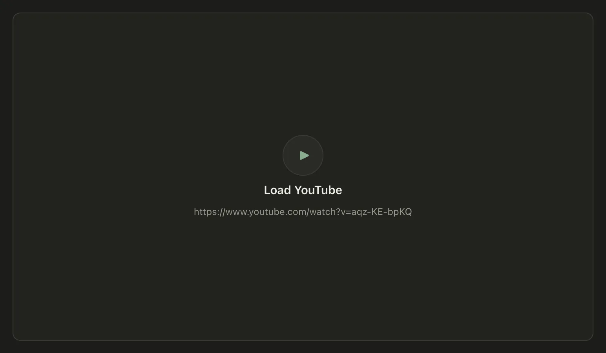

## Meeting

### Decision

Starts a line with **Decision:** in bold, to write a decision while you take notes. To have it listed in the Library, use a [decision callout](#decision-callout).

Markdown: `**Decision:** …`.


### Open question

Starts a line with **To clarify:** in bold, for something to sort out later.

Markdown: `**To clarify:** …`.


### Current time

Writes the time of day, such as `10:42`, as plain text.


### Mark the moment

Marks the recording time, like ⇧⌘M while recording. When the meeting ends, the AI writes what was being said at that minute; you can also write it yourself. ↗ opens the transcript at that point.

Markdown: `::: moment 12:34` … `:::`.

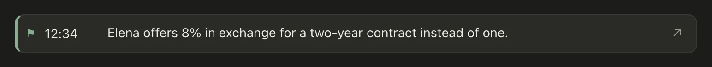

### Transcript quote

A sentence said in the meeting, with who said it and the minute. The quickest way to make one is to select text in the Transcript panel and press **❝ Quote** (while recording, the same button at the bottom of the panel quotes the last sentence); the command inserts an empty one to fill in, at the current minute of the recording. Quotes are listed in the [Library](/guides/library/#items-across-meetings).

Markdown: `::: quote 12:34 Name` … `:::`.

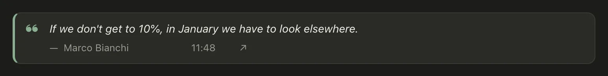

### Ask the AI

A request about the meeting, such as "What are the client's objections?", with its answer under it. The answer is recomputed while you record and once more when the transcription ends; ↻ asks again. It sends the notes and the transcript to the AI provider you configured: see [privacy levels](/privacy/levels/) for meetings where that must not happen.

Markdown: `::: ai Request` … `:::`.

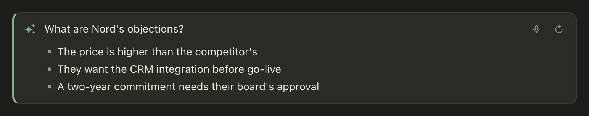

## Tools

Polls, kanban boards, timelines, pros and cons, decision matrices and diagrams have a **✦** button that creates or edits the block from a request written in your words. Like every AI feature, it sends the notes and the transcript to your provider.

### Poll

A question with options and votes, for a quick count in the meeting. − and + change the votes; the leading option is highlighted.

Markdown: `::: poll Question`, then `- [votes] option` for each option, then `:::`.

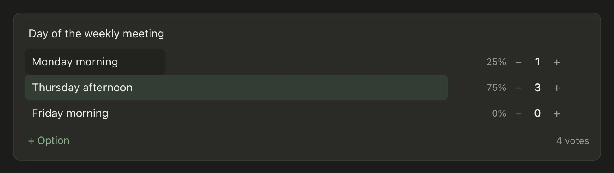

### Kanban board

Columns of cards, To do, In progress and Done to start with. Drag a card to another column, or move it with the arrows; the column names can be changed.

Markdown: `::: kanban`, a `## Column` heading per column and a `- card` per card, then `:::`.

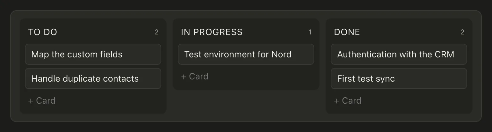

### Timeline

Milestones with their dates, in order along a line. Past milestones are dimmed and the next one is highlighted. Add one at the bottom with its date.

Markdown: `::: timeline`, then `- 2026-12-10 Milestone` per milestone, then `:::`.

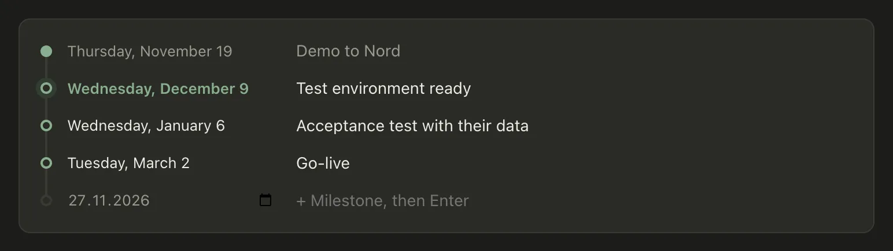

### Pros and cons

Two columns, pros and cons, and a verdict under them.

Markdown: `::: pros-cons`, then `+ pro`, `- con` and `= verdict` lines, then `:::`.

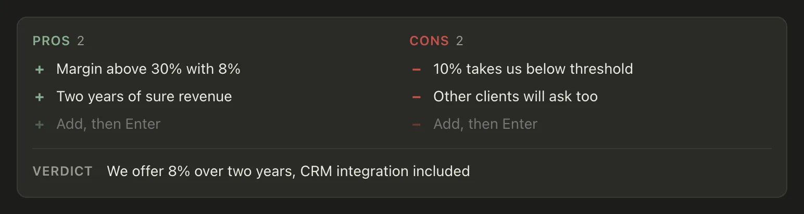

### Decision matrix

Options compared on weighted criteria. The total of each option is the sum of weight × score, and the highest total is highlighted. **+ Criterion** and **+ Option** add rows and columns.

Markdown: a table inside `::: matrix` … `:::`, with criteria in the first column and weights in the second.

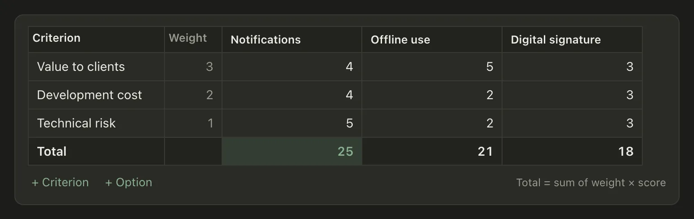

### Rating

One to five stars inside a sentence. Click a star to change it.

Markdown: `[[rating:4]]`.


### Timer

A countdown for a point on the agenda, five minutes to start with: write another duration in minutes, or minutes:seconds. Start, pause and reset it; a notification says when the time is up. Only the duration is saved: when you reopen the note the timer is stopped and ready.

Markdown: `[[timer:05:00]]`.


### Progress

A bar with how many action items are done in its section: from the heading above it to the next heading of the same level. Without a heading above, it counts the whole note. It stores no numbers, it counts the checkboxes each time.

Markdown: `[[progress]]`.

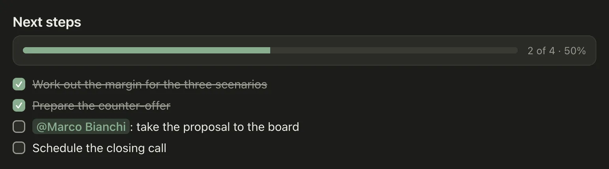

### Chart

Draws the nearest table above it: the first column gives the labels, the other columns the numbers. The chart follows the table as you edit it, and switches between bars and lines.

Markdown: `[[chart:bar]]` or `[[chart:line]]`; the data stays in the table.

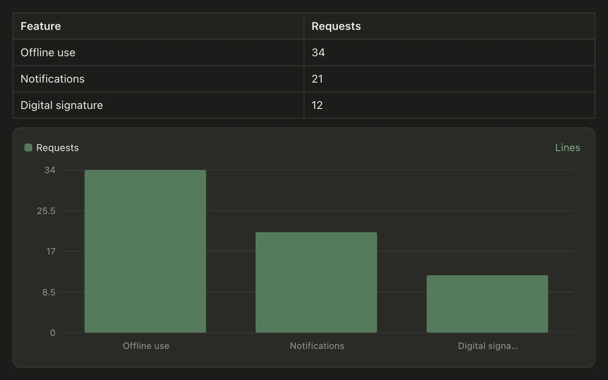

### Diagram

Flows and sequences written as text in [Mermaid](https://mermaid.js.org/), drawn in the note. **Edit the diagram** shows the text.

Markdown: a `mermaid` code block.

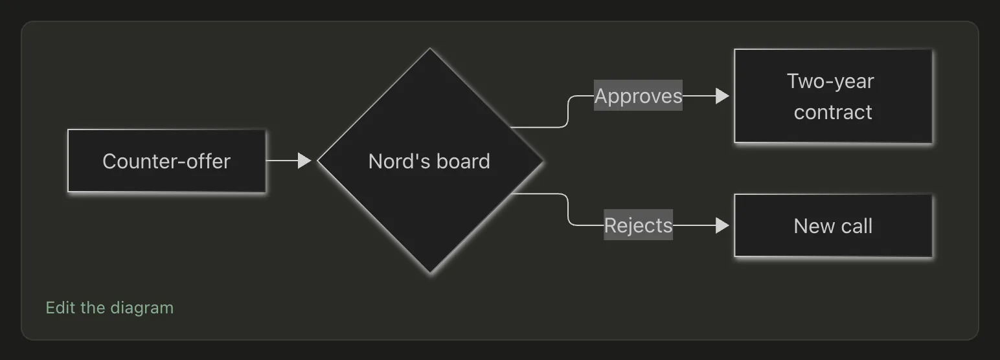

### Whiteboard

A freehand sketch, in four colours. **✦ To diagram** has the AI read the sketch and put a Mermaid diagram under it.

Markdown: a `sketch` code block: the size, then one line per stroke.

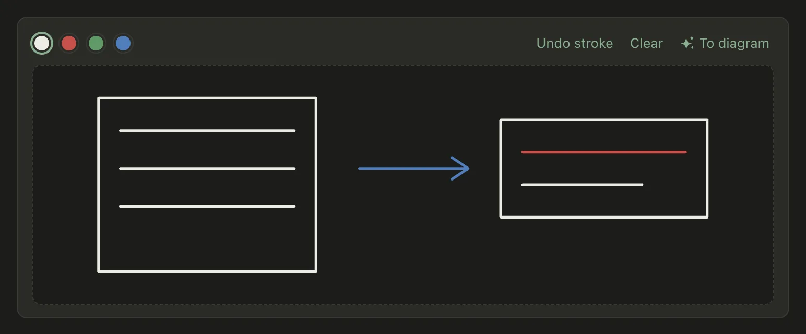

## People and dates

### Person

Mentions a person: type a name and choose from your contacts and the people in your calendar, or use a new name as it is. The `@` key opens the same list.

Markdown: `@[Name Surname]`.

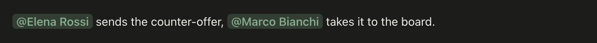

### Today's date

Inserts today's date as a date, shown as "Today" or as the weekday and day. Click it to choose another day.

Markdown: `[[2026-11-26]]`.


### Tomorrow's date

The same, with tomorrow's date.


