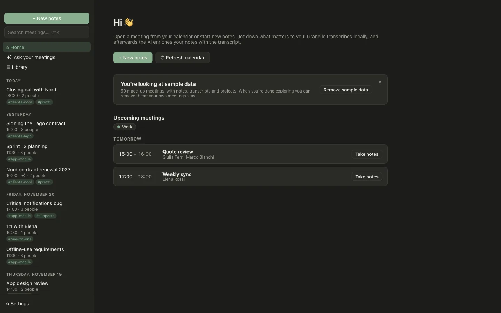
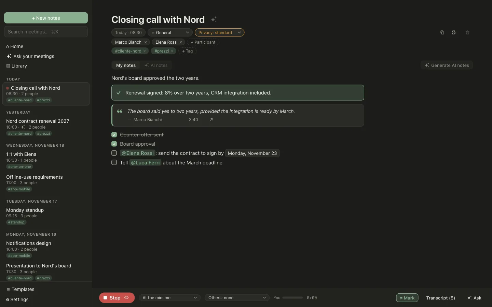
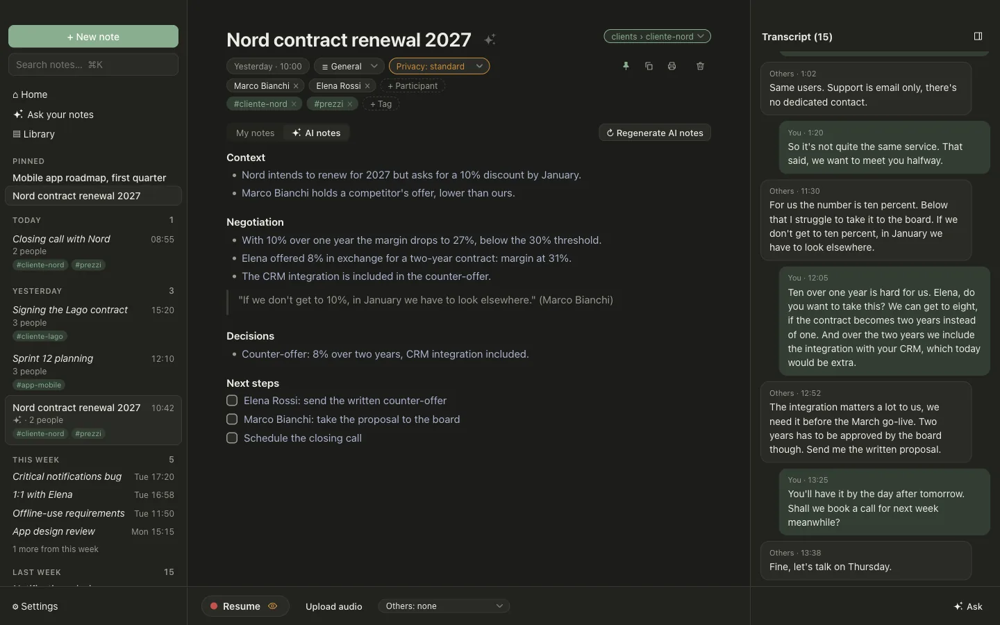

The Home screen shows what is still missing after the first launch. There are three things to set up, all in **Settings**.

## Set up

1. **Local transcription**: download a whisper model. `large-v3-turbo-q5_0` (547 MB) is the recommended one on Apple Silicon; `base` is enough for a quick try.
2. **AI models**: paste the API key of your provider, or add a local provider. The key goes to the macOS Keychain. See [local models](/privacy/local-models/) to keep everything on your Mac.
3. **Calendar** (optional): add a calendar by pasting its secret iCal address. Upcoming events then appear on the Home screen, with one click to open their notes.

To look around first, **Load sample data** on the Home screen fills the app with 22 made-up meetings. They are removed with one click and never touch your own meetings. If you don't need the card, close it with the ×: the sample data stays in Settings → Data and privacy.

## Record

1. Press **New notes** (⌘N), or **Take notes** on a calendar event.
2. Choose the meeting's **Privacy** level in the header, if it should not be the standard one. See [privacy levels](/privacy/levels/).
3. Press **Record**. The first time, macOS asks for permission to use the microphone.
4. Write the few things that matter to you. Press **⚑ Mark** (⇧⌘M) when something important is said: the note keeps the minute.
5. Press **Stop**.

## Get the notes

Open **Transcript** to read what was said, with who spoke and the minute. Then press **Generate AI notes**: the model merges your notes and the transcript into complete notes, following the meeting's template. The AI notes stay editable, and your own notes are kept in their tab.

Next: [how privacy works](/privacy/overview/).
